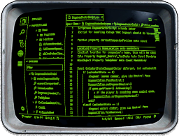
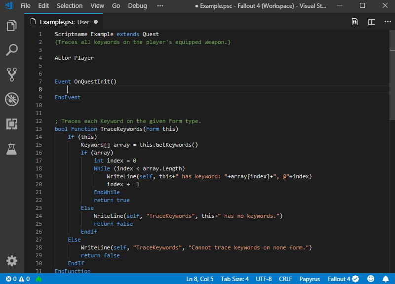

# 📜 Papyrus Language Tools

A compiler, language server and Visual Studio Code extension for Papyrus, the scripting language of Skyrim, Fallout 4 and Starfield.

## ✒ Visual Studio Code Extension

🔗 [Visual Studio Marketplace](https://marketplace.visualstudio.com/items?itemName=joelday.papyrus-lang-vscode)
📖 [Usage](src/papyrus-lang-vscode/README.md)
⚙️ [Source](src/papyrus-lang-vscode)

 

## 🛠 Contributing

Building, the compiler, the repository layout and the release process are covered in [CONTRIBUTING.md](CONTRIBUTING.md).

## 🎖 Credits

- 🥇 joelday
- Scrivener07
- shad0wshayd3
- rjstone
- fireundubh (for Pyro)
- Nyo (Pyro fixes)
- [Caprica](https://github.com/Orvid/Caprica) and [Champollion](https://github.com/Orvid/Champollion) by Orvid
- [Git](https://icons8.com/icon/0HyDNss5DL1B/git) and [Folder](https://icons8.com/icon/5nzoHCbP0E0i/folder) icons by [Icons8](https://icons8.com)
