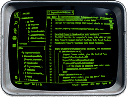
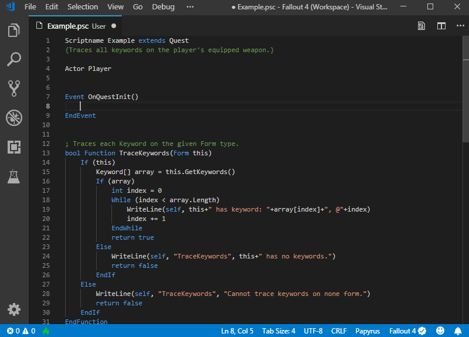

# 📜 Papyrus Language Tools

[](https://marketplace.visualstudio.com/items?itemName=joelday.papyrus-lang-vscode)
[](https://discord.gg/E4dWujQ)

## Advanced language tools for the Papyrus scripting language.

You can now write mods for Fallout 4 and Skyrim with the aid of modern code editing features such as code completion, jump to definition, hover, symbol search, PPJ-based build tasks, and live updated diagnostics.

## Building

Requires the .NET SDK pinned in `global.json` and Node 22.

```
dotnet build Papyrus.sln -c Release      # compiler, language server, tests
dotnet test Papyrus.sln -c Release
cd src/papyrus-lang-vscode && npm ci && npm run build-server && npm run compile
```

`npm run build-server` publishes the NativeAOT language server for your machine into `bin/<rid>/`, where the extension looks for it. The native xSE debug plugin (`DarkId.Papyrus.DebugServer.sln`) builds on Windows with VS 2022 and vcpkg; see [its README](src/DarkId.Papyrus.DebugServer/README.md). See [CONTRIBUTING.md](CONTRIBUTING.md) for the branch and release flow.

## Compliance

Byte-identical PEX is the gate. Semantic-equivalence exceptions live in [`docs/compliance/allowlist.md`](docs/compliance/allowlist.md) (reviewed like code). Public CI never needs game files:

```
papyrusc verify --compile --game skyrimse
```

skips with exit 0 when `./corpus/skyrimse` is absent. With a local corpus (see [docs/corpus.md](docs/corpus.md)):

```
papyrusc verify --compile --game skyrimse --source ./corpus/skyrimse --baseline docs/compliance/baselines/skyrimse.json
```

Tier 2 (`--ck-compiler`) is not implemented yet. See [docs/compliance/baselines/README.md](docs/compliance/baselines/README.md).

## ✒ Visual Studio Code Extension

Updated frequently with new features and improvements.


🔗 [Visual Studio Marketplace](https://marketplace.visualstudio.com/items?itemName=joelday.papyrus-lang-vscode)
📖 [User Manual](https://github.com/joelday/papyrus-lang/wiki)
⚙️ [Source](src/papyrus-lang-vscode)

<br />



## 🎖 Credits

- 🥇 joelday
- Scrivener07
- shad0wshayd3
- rjstone
- fireundubh (for Pyro)
- Nyo (Pyro fixes)
- [Git](https://icons8.com/icon/0HyDNss5DL1B/git) and [Folder](https://icons8.com/icon/5nzoHCbP0E0i/folder) icons by [Icons8](https://icons8.com)