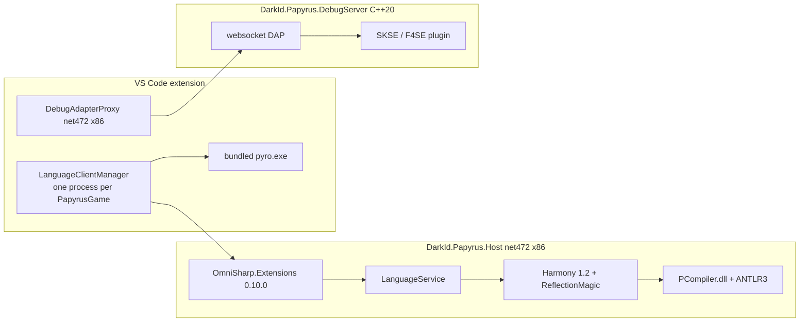
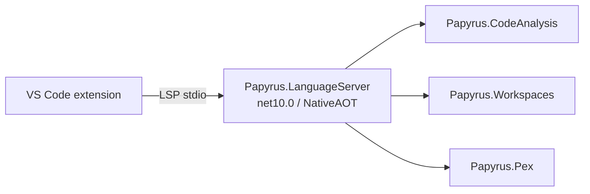
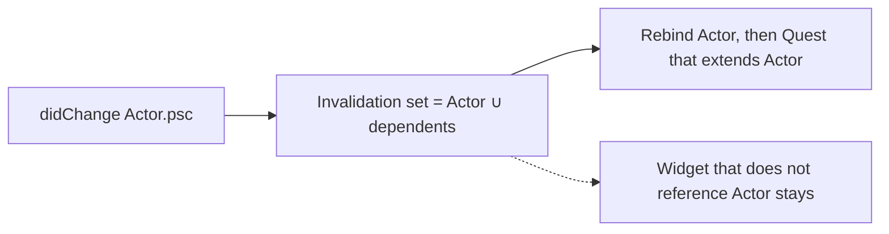
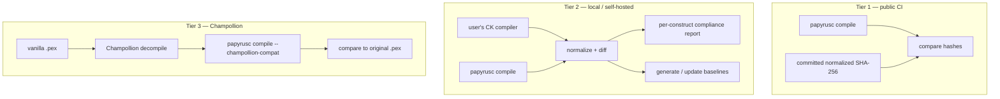
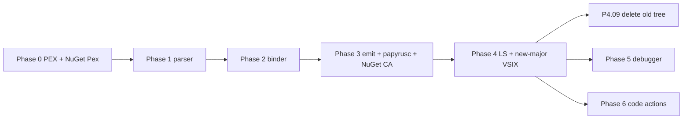
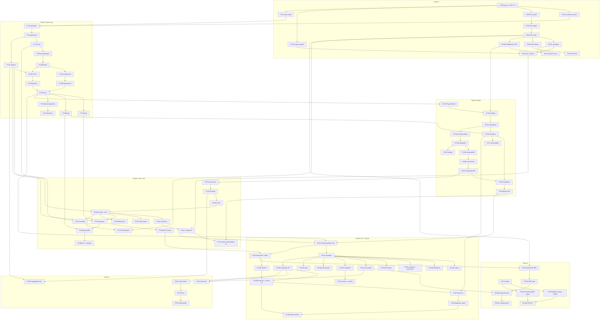

# Papyrus Compiler and Language Service Overhaul

| Field | Value |
|---|---|
| **Author** | Joel Day |
| **Status** | Accepted — pending implementation |
| **Date** | 2026-08-16 |
| **Repo** | [joelday/papyrus-lang](https://github.com/joelday/papyrus-lang) |
| **Prepared against** | `cde275a` (`develop`, 2025-04-29) |
| **Language / PEX reference** | [Orvid/Caprica](https://github.com/Orvid/Caprica) `@ e4dee08` (`master`, 2024-06-14) |
| **HEAD at writing** | `cde275a2b17110f87cbf9e208a04da40e39e66db` — no drift from the source snapshot |

This document specifies a clean-slate Papyrus compiler and a **big-bang product cutover** of the language service onto it. All product questions in [Closed Questions](#closed-questions) are decided. The compiler is built incrementally as PRs (phases 0–3). **Nothing ships to Marketplace users until emit meets the compliance bar.** Then one cutover: a new-major VSIX with `Papyrus.LanguageServer` + `papyrusc` replaces the OmniSharp / PCompiler host. There is no dual-engine process and no PCompiler helper.

---

## Overview

papyrus-lang today has no Papyrus parser. The language service loads Bethesda's closed-source `PCompiler.dll`, rewrites its IL at runtime with Harmony 1.2, reaches into private fields with ReflectionMagic, and re-wraps the resulting ANTLR3 `CommonTree` into a second tree. Every long-standing tracker issue — 32-bit OOM, Windows-only, no Starfield, discarded syntax errors, hash-code-only identity, rename that cannot see comments, crashes under circular references — is a downstream consequence of that single architectural fact.

The proposed fix is to write the compiler. A new `Papyrus.CodeAnalysis` stack (red/green syntax, lazy symbols, lowering, deterministic PEX emit) is built in a new solution against a corpus harness with **zero LSP obligations** until phase 3 exit. Official syntax only ships first; Caprica-style language extensions are designed for, behind a distinct `LanguageVersion`, and remain a post-compliance decision (P6.05). The existing OmniSharp / PCompiler extension stays the shipping product, untouched, until `papyrusc` produces compliant PEX. Then one cutover: a new-major VSIX launches one `Papyrus.LanguageServer` (every dialect in one process) and the old Host is gone. Rollback is “install the previous Marketplace VSIX,” not a mixed-engine setting. PCompiler is deleted from the tree when that new VSIX is the default release.

---

## Background & Motivation

### Current architecture

The managed surface is eleven `net472` / `PlatformTarget x86` projects in `DarkId.Papyrus.sln`, compiling six roles twice (once per `#define FALLOUT4` / `#define SKYRIM`). The VS Code extension (`src/papyrus-lang-vscode`, 3,562 lines of TypeScript) launches one Host process per enabled game:



There is no Release configuration for any managed project (`<Configurations>Debug</Configurations>` in every `.csproj`; `DarkId.Papyrus.sln` lists only `Debug|Any CPU`). `PathResolver.getLanguageToolPath` hard-codes `./bin/Debug/net472/DarkId.Papyrus.Host.{Game}/...`. The extension ships a Debug build with full PDBs.

### Root-cause table (verified at `cde275a`)

| Root cause | Evidence in tree | Tracker symptoms |
|---|---|---|
| PCompiler is an x86 CLR2-era assembly | All 11 `.csproj` files: `<TargetFramework>net472</TargetFramework>` + `<PlatformTarget>x86</PlatformTarget>` | **#182** `OutOfMemoryException` (~1.4 GB usable address space) |
| PCompiler is a Windows PE, patched by Harmony 1.2 | `Lib.Harmony` `1.2.0.1`; `HarmonyInstance.Create("PapyrusHarmonyPatch")` in `HarmonyPatches.cs` | **#198** Linux support |
| Adding a game means a new `PCompiler.dll` and a new `AstType` enum | `External/AstType.cs`: 131 Fallout 4 members + 103 Skyrim members, different numbering | **#194** Starfield, **#207** Oblivion blocked |
| Compiler assemblies downloaded unversioned from Dropbox | `build.cake:80` `DownloadFile("https://www.dropbox.com/s/vkoffvsdhru7p1c/papyrus-compilers.zip?dl=1")` | **#200** `FileLoadException`; supply-chain / redistribution |
| Parser errors deliberately discarded | `ScriptCompiler.ParsePatch` (`ScriptCompiler.cs:161-162`): *"Currently suppressing parser errors so that the compiler will continue with type resolution"* | Syntax errors never reported; only `CommonErrorNode` tree-shape damage is visible (`NodeBinder.cs:885-888`) |
| Compiler AST is not re-entrant | `ScriptFile.cs:180-186` re-runs `compileFunc()` whenever any diagnostic was produced | Every keystroke = full `LoadObject` + type walk + bind, **twice** while typing |
| Cross-file invalidation is local | `ScriptFile.HandleScriptTextChanged` (`ScriptFile.cs:271-293`) removes only the edited script's own keys from the global type table | Dependents that `extends` the edited script keep stale types |
| `CachedValue` holds its lock across a compile; `LoadObjectPatch` reaches into another file's `CachedValue` while holding the first | `CachedValue.cs:26-31`; `ScriptCompiler.LoadObjectPatch` at `ScriptCompiler.cs:109-111` reads `ScriptFiles[objectIdentifier].CompilerType` | Latent lock-order inversion. Circular refs re-enter and throw `InvalidOperationException` (`CachedValue.cs:40-43`), surfaced as a line-0 diagnostic. **#209**, **#90**, **#89** |
| `ObjectIdentifier.Equals` / `operator==` compare hash codes only | `ObjectIdentifier.cs:115-138`. It is the key type of `PapyrusProgram._scriptFiles` and `TypeChecker._arrayTypes` | Two script names with a 32-bit hash collision silently alias. Deterministic per name-pair |
| `TokenEqualityCachedValue` invalidates on hash codes only | `TokenEqualityCachedValue.cs:20` via `HashCodeEquals` in `CoreExtensions.cs:16-24` | Colliding hashes = stale tree, never invalidated |
| No trivia model | `SyntaxNode.Text` is a trimmed source slice (`NodeBinder.cs:890-902`). `GetLeadingComments` scrapes `LeadingText` with `TakeWhile(t => t.StartsWith(";"))` (`SyntaxExtensions.cs:173-191`) | No formatter possible (**#39**). **#87** multi-line `;/ /;` comments invisible. **#73/#74/#75** rename is a text op over a lossy tree |
| Symbol lookup rebuilds a LINQ pipeline per call | `SemanticExtensions.GetScriptMemberSymbols` ends in `DistinctBy(s => s.Name + "_" + s.Kind, ...)` (`SemanticExtensions.cs:115`) | O(inheritance depth × members) with allocations on every hover / completion / find-references |
| `SymbolBindingVisitor` uses `AsParallel().ForAll` | `SymbolBindingVisitor.cs:37`; first-write-wins into `scope.ScopedSymbols` under a lock (`:58-63`) | Which of two same-named symbols wins varies run to run |
| `TaskExtensions.WaitForResult` calls `task.Wait()` | `TaskExtensions.cs:10-19`. After `Wait()`, the `IsFaulted` branch that returns `default(T)` is unreachable: `Wait()` already threw `AggregateException` | Unhandled exceptions surface from Harmony prefixes inside Bethesda IL. Shape of most crash reports |
| Position lookup is a linear scan | `SyntaxExtensions.GetNodeAtPositionInternal` (`:41-51`) walks every child at every level over ranges mutated during `NodeBinder` construction | Hover / completion / definition are O(n) per request |
| Two `#define`s compile the same sources twice | **84** `#if FALLOUT4` / `#if SKYRIM` / `#elif SKYRIM` across **19** non-test files; **93** across **22** including tests | 11 projects for 6 jobs |
| Secondary age layer | OmniSharp LSP **0.10.0** (still shipping `OmniSharp.Extensions.Embedded.MediatR`); `Microsoft.Extensions.*` **2.2.0** in compiler-facing projects, **7.0.0** in DebugAdapterProxy; MSTest **1.4.0**; `vscode-languageclient` **^5.2.1**; RxJS **6**; `Lib.Harmony` **1.2.0.1** | **24** live `[TestMethod]`s (a 25th is fully commented out), zero covering the language server, debug adapter, or extension |

Five Harmony patches exist; four are active in any single build:

| Patch | File | Game | Purpose |
|---|---|---|---|
| `AntlrPatch` | `External/AntlrPatch.cs` | both | Process-global `_textProvider` static; prefixes `ANTLRFileStream.Load` |
| `LoadObjectPatch` | `ScriptCompiler.cs:78` | both | Cross-file type reuse by reflecting into another `ScriptFile.CompilerType` |
| `ParsePatch` | `ScriptCompiler.cs:143` | both | Replaces `Compiler.Parse`; discards parser errors |
| `TypeCheckPatch` | `ScriptCompiler.cs:46` | Skyrim only | No-ops Skyrim `TypeCheck` so a subsequent walk can succeed |
| `ScriptFunctionTypeCtorPatch` | `ScriptCompiler.cs:62` | FO4 only | Substitutes `"__Unknown__"` for an empty function name so `Foo.` still parses |

### Additional current-state facts the rewrite must not lose

- **Doc comments are already semantically modeled.** `DocCommentNode` / `IDocumentable` exist; hover surfaces them via `ScriptSymbol.Documentation`. Ordinary comments are the loss.
- **Remote `.ppj` imports already exist.** `SourceInclude` (`ProgramOptions.cs:58-315`) implements Pyro-compatible GitHub / Bitbucket / Gitea remotes (SHA1-prefix cache under `RemotesInstallPath`). **#195** is closed. The new project system must keep this.
- **Array members are fake source.** `TypeChecker.CreateArrayTypeSource` writes a synthetic `.psc` and feeds it back through `PapyrusLexer` / `PapyrusParser`. `PropertySymbol.Name` then rewrites `Length_` → `Length` (`Symbols.cs:190-193`) because the pseudo-source cannot declare a property actually named `Length`.
- **`WorkspaceManager` has a dead branch.** `WorkspaceManager.cs:109-116`: both the `if` and the `else if` test `.psc`. The second was almost certainly meant to test `.flg` or `.ppj`. Combined with **#94** (PPJ not reloaded on change — `DidSave` reloads `.ppj`, `DidChangeWatchedFiles` does not).
- **`DiagnosticLevel` has a single member: `Error`.** There is no warning / info / hint, no stable ID, no category. Internal exceptions are logged and sometimes reported at line 0.
- **Cancellation is decorative outside find-references.** OmniSharp handler signatures all take a `CancellationToken`; the only language-service API that actually accepts one is `SemanticExtensions.FindReferences`. The parameterless overload passes `CancellationToken.None`.
- **CI is Windows-only Cake.** `.github/workflows/build.yml` runs on `windows-latest`, clones the repo to `c:/repo`, installs vcpkg, then `dotnet cake`. No Linux job, no managed-only job, no test gate independent of the Dropbox compilers.
- **Current size (measured at `cde275a`).** 11,107 lines of non-test C#, 5,659 lines of DebugServer C++/headers, 3,562 lines of extension TypeScript, 692 lines of C# tests, **24** live `[TestMethod]`s (a 25th in `CreationKitInisConfigLoaderTests.cs` is fully commented out). Caprica's "~21k lines of C++" is an external figure, not re-measured in this tree.

### Why not modernize the wrapper

A version-bump of OmniSharp, a net8 retarget, or a 64-bit host cannot happen while PCompiler is in-process: it is x86, Windows PE, CLR2, and reached through Harmony 1.2. The `#if` split, the hand-transcribed `AstType` tables, the Dropbox compilers, and the inability to add Starfield are all properties of wrapping Bethesda's parser rather than owning one. The fix is to write the compiler.

---

## Goals & Non-Goals

### Goals

1. A Papyrus compiler that is the language service's only front end, owned in-tree, with no Bethesda binary at runtime.
2. Official-syntax compliance that is a number, not an opinion: byte-identical PEX as the gate, semantic equivalence as the documented floor, against the vanilla corpora of Skyrim SE, Fallout 4, and Starfield.
3. Incremental *compiler* PRs (phases 0–3) with independently useful libraries and `papyrusc`. **No editor feature ships** until phase 3 exit (compliant emit). Then one LS + extension cutover (phase 4). PCompiler leaves the tree when the new-major VSIX is the default release.
4. Cross-platform NativeAOT binaries for `win-x64`, `linux-x64`, `osx-arm64` (language server, compiler CLI, debug adapter).
5. A standalone `Papyrus.Pex` library that can read PEX 3.1–3.15 (including FO76), write the versions we emit, assemble/disassemble PAS, and reflect symbols from source-less `.pex` dependencies.
6. Design-for, not ship, Caprica's language extensions (`For`, `ForEach`, `Switch`, `Do`/`LoopWhile`, `Break`/`Continue`, `Auto` locals) as a distinct `LanguageVersion`.
7. Reliability invariants with enforcement: total functions, cancellation everywhere, no shared mutable state, confluent parallelism only, bounded memory, corpus-plus-fuzzing, performance gates, structured observability.

### Non-goals

- Fallout 76 as a compile target. The `GameId` slot stays so the PEX reader can *read* FO76 files (PEX 3.15, `ArrayGetAllMatchingStructs`). We do not claim to compile for FO76.
- Oblivion / Oblivion Remastered. **#207 is out of scope** for this overhaul (Closed Question 5). Dialects-as-data does not put it on the schedule. Do not implement, evaluate, or schedule it here.
- A third-party analyzer / code-fix plugin surface. Ship built-in fixes; do not take Roslyn's extensibility obligation.
- Public API compatibility across 0.x. We will break our own APIs between 0.x releases.
- Incremental reparse (`Blender`) in phase 1. Designed for; built only if the phase-1 benchmark gate says it is needed.
- Replacing the in-process C++ xSE plugin. It has to stay in-process; we modernize around it.
- Shipping Caprica extensions before compliance is proven.
- Redistributing Bethesda compiler binaries, vanilla `.psc` / `.pex` corpora, or any Creation Kit payload.

---

## Key Decisions

| # | Decision | Status | Rationale |
|---|---|---|---|
| K1 | **Write the compiler.** Do not modernize the PCompiler wrapper. | Confirmed | Every long-standing issue is downstream of not owning a parser. Wrapping cannot become 64-bit, cross-platform, or Starfield-capable. |
| K2 | **Dialects: Skyrim SE, Fallout 4, Starfield. Not FO76.** Skyrim LE rides via `GameId` + PEX version mapping without a testing commitment. FO76 remains readable. | Confirmed | Matches the games authors actually target. FO76 costs a PEX version and nothing else; its distinctive opcode is already in Starfield's range in Caprica. |
| K3 | **Compliance bar: byte-identical PEX as the gate, semantic equivalence as the documented floor.** Allowlist is a reviewed file; CI reports its size; expected to shrink. K24 is the operational definition of semantic equivalence **for allowlisted constructs only**. | **Confirmed** | "Fully compliant" without an oracle is an opinion. With one, it is a number. Caprica already publishes a four-item list of deliberate CK divergences. |
| K4 | **Delivery: big-bang product cutover.** Compiler PRs land incrementally in phases 0–3 with zero editor obligations. **Ship nothing to users until emit works (phase 3 exit).** No dual-engine, no PCompiler helper, no `papyrus.languageEngine`. The OmniSharp / PCompiler VSIX stays the shipping product, untouched, until then. Cutover is a **new-major VSIX**; the previous VSIX stays installable. PCompiler is deleted from the tree when the new VSIX is the default Marketplace release. | **Confirmed** | Incremental LS migration was rejected. Cost: long dark stretch, no formatter / Linux LS until emit. Benefit: compiler design is never bent by OmniSharp; no mixed-engine process; rollback is a VSIX channel, not a setting. |
| K5 | **Official syntax only, with extensions designed for.** Caprica extensions are a later `LanguageVersion`, opt-in, after compliance. Shipping them is still a post-compliance decision (P6.05 gated). | **Confirmed** | Compliance is only meaningful against the CK if the syntax surface is the CK's. |
| K6 | **Dialects are data, not `#if`.** One binary per role. `PapyrusDialect` static instances. | Confirmed (architecture) | Today's 84 preprocessor directives and dual builds are why Starfield is blocked and why keywords like `Struct` cannot be identifiers in Skyrim. |
| K7 | **Red/green trees, full fidelity enforced.** `Parse(t).GetRoot().ToFullString() == t` is an invariant, not an aspiration. | Confirmed (architecture) | Formatter, comment-preserving rename, and code fixes are impossible without it. That is the real cause of **#87** and **#73/#74/#75**. |
| K8 | **No semantic information in the parser.** `A.B.C` is a qualified name; the binder decides namespace vs. script vs. variable. | Confirmed (architecture) | Today's `DisambiguateType` reflection under a lock is both a hot-path tax and incorrect in FO4/Starfield where namespaces and locals collide. |
| K9 | **Symbols are separate from syntax.** Intrinsics are synthesized, not fake source. Binding is lazy with an explicit completion-state machine. | Confirmed (architecture) | Directly eliminates the `Length_` hack, the lock-order inversion, and the re-entrant `InvalidOperationException`. |
| K10 | **`Papyrus.CodeAnalysis` has no I/O and no `System.Reflection`.** Enforced by architecture test. NativeAOT for every shipped binary. | Confirmed (architecture) | Makes the compiler testable, in-process-hostable, and AOT-clean. No-reflection is a phase-0 discipline, not a publish-time surprise. |
| K11 | **`Papyrus.Pex` is standalone.** Milestone-one test is read/write byte-identical over the vanilla PEX corpora, before any parser exists. | Confirmed (architecture) | Independently valuable; establishes the oracle everything downstream is measured against. |
| K12 | **Drop OmniSharp 0.10.0.** Default replacement: `StreamJsonRpc` + `System.IO.Pipelines` + source-generated STJ, thin typed LSP layer. Reversible because handlers sit behind our interfaces. | Confirmed lean (alternative noted) | OmniSharp 0.10.0 handler contracts already changed upstream; a version bump is a rewrite. Its MediatR dispatch fights NativeAOT. |
| K13 | **Incrementality investment goes into the symbol layer, not the parser.** Green trees make a `Blender` possible later. | Confirmed (architecture) | **Hypothesis (unmeasured):** vanilla median is hundreds of lines and a span lexer + RD parser reparses a typical script in well under 1 ms. P0.09 / P1.10 measure this. Re-binding the dependency graph is expected to be the expensive part. |
| K14 | **`PapyrusName` compares strings.** Replaces `ObjectIdentifier`'s hash-code-only equality. | Confirmed (architecture) | Hash-code equality silently aliases scripts. Deterministic and project-breaking. |
| K15 | **Deterministic emit.** No timestamps in output, stable ordering, no parallelism that affects bytes. Temps pooled per type, matching CK reuse order. | Confirmed (architecture) | Required for byte-identical baselines. Temp reuse order is the schedule-risk center; the differential harness exists for it. |
| K16 | **Keep the C++ xSE plugin.** Replace `DebugAdapterProxy`. Add SFSE. Move Address Library IDs to versioned data. | Confirmed (architecture) | The plugin must be in-process. The proxy's hand-rolled DAP framing is independently replaceable. |
| K17 | **Do not adopt** Roslyn's public-API obligation, analyzer plugin surface, Workspaces MEF layer, records for green nodes, or premature incremental reparse. | Confirmed (architecture) | Roslyn is a 2010–2014 design with a decade of compatibility. The ideas are right; several mechanisms are dated. |
| K18 | **One LS process, many dialects, no helper.** At cutover the extension launches **one** `Papyrus.LanguageServer`. That process hosts every dialect as immutable compilations. There is no PCompiler helper, no `papyrus/helper/v1`, and no OmniSharp after cutover. Until cutover the shipping extension continues to launch `DarkId.Papyrus.Host.{Game}`. The two trees do not share projects or a TFM. | **Confirmed** | One process is better for memory and multi-root (**#193**). Isolation of the *old* engine is a separate VSIX, not a second process. |
| K19 | **Source encoding is a parse/emit input.** Default decode is Windows-1252 (CK historical). UTF-8 is accepted when a BOM is present or `--encoding utf-8` / `PapyrusParseOptions.Encoding` is set. Emit writes the string table in the same encoding the CK uses for that dialect (Windows-1252 for SSE/FO4; Starfield confirmed by tier-2). | Confirmed (architecture) | Byte-identical PEX is impossible if identifiers and string literals are UTF-8 while the CK wrote ANSI. |
| K20 | **Debug info is a deterministic emit mode.** Written unless `Release` or `--no-debug-info`. Line maps come from red-tree full-spans, sorted stably. `Final` / `Optimize` do not strip debug info by themselves. The C# writer is contract-tested against the Champollion reader the DebugServer already uses (`Pex.h` → `Champollion/Pex/Binary.hpp`). | Confirmed (architecture) | The debugger needs line maps; the differ may strip them. `--time 0` must not scramble line tables. |
| K21 | **Import resolution is first-match on the ordered include list, then remotes, then PEX-only fallback.** Dirty LSP buffers shadow the same path. `Namespace:Script` maps to `Namespace/Script.psc` (FO4+/Starfield). Last-match is a bug. | Confirmed (architecture) | Matches Pyro / CK include order. Remotes stay Pyro-compatible HTTPS import *paths*, not a schema element named `remotes`. |
| K22 | **`papyrusc` is the supported build tool.** Pyro is not downloaded or bundled after P3.06. `.ppj` `${ENV}` expansion and pre/post build events (**#145**, **#148**) are implemented in `papyrusc` so deleting the Pyro *requirement* does not regress those projects. A user-supplied `pyro.exe` remains an optional task shim, not a supported backend we test. **Build events default off in the language server** (`papyrus.ppj.allowBuildEvents`, default `false`); they run for explicit `papyrusc compile project.ppj` (CLI default `true`). cwd = the `.ppj` directory; no env beyond the process environment already used for `${ENV}`. | Confirmed (architecture) | Preserves existing project semantics without an unpinned third-party download, without giving the LS unsandboxed spawn by default. |
| K23 | **Binder concurrency: `ForceComplete` is re-entrant and parallel-safe.** Related scripts may complete concurrently. Each completion part is a single-assignment slot (`Interlocked` CAS). A waiter that finds `InProgress` awaits that part's `Task`; it never takes a compile-wide lock. Cycle detection uses a per-compilation "completing" set keyed by `(symbol, part)`. | Confirmed (architecture) | Replaces `CachedValue` lock-across-compile without serializing the DAG. |
| K24 | **Semantic equivalence (allowlisted constructs only)** means: identical Champollion-normalized decompile after renaming `::tempN` and ignoring instruction-local register assignment, **plus** identical accept/reject (and positions) on the negative corpus. Same opcode stream after temp rename is a stricter optional report, not the floor. | **Confirmed** (operational definition) | Applies only to constructs on the reviewed allowlist. Everything else must be byte-identical (K3). |
| K25 | **Publish `Papyrus.Pex` and `Papyrus.CodeAnalysis` as public 0.x packages on nuget.org.** No stability promise. 0.x may break. API discipline is required (nullable, no accidental public surface); no compatibility obligation. | **Confirmed** | Lets other tools build on the libraries instead of shelling out to a compiler. Pack+publish: Pex in phase 0, CodeAnalysis in phase 3. |
| K26 | **Skyrim LE is carried, with no corpus gate and no LE compliance number.** Keep `GameId.Skyrim`, `SkyrimLe` dialect, `papyrusc --game skyrimle`, and the existing extension toggle / generate-project. | **Confirmed** | Same language and opcode set as SSE; PEX 3.1 / 3.2 mapping only. |
| K27 | **Oblivion / Oblivion Remastered (#207) is out of scope.** Not a compile target. Not on the roadmap. Dialects-as-data does not schedule it. | **Confirmed** | Owner decision. Do not implement or evaluate it in this overhaul. |
| K28 | **Repo strategy: new top-level tree inside `papyrus-lang`.** `Papyrus.sln` + `src/Papyrus.*` sit next to `DarkId.Papyrus.sln`. This design file lives at `docs/design/compiler-and-language-service-overhaul.md`. Issue tracker and VSIX history stay here. | **Confirmed** | One tracker, one Marketplace extension id. |

---

## Proposed Design

### Solution layout

Confirmed (K28): a new top-level tree inside this repo, so the issue tracker and the extension's Marketplace history stay put.

```
Papyrus.sln
src/
  Papyrus.CodeAnalysis/                 net10.0   syntax, symbols, binding, lowering, emit. No I/O. No reflection.
  Papyrus.CodeAnalysis.Generators/      netstandard2.0  syntax nodes, visitors, factories, diagnostics
  Papyrus.Pex/                          net10.0   PEX read/write/normalize, PAS assemble/disassemble
  Papyrus.Workspaces/                   net10.0   project system, .ppj/.flg, resolvers, file watching
  Papyrus.LanguageServer/               net10.0   LSP, NativeAOT-published
  Papyrus.Compiler/                     net10.0   papyrusc CLI, NativeAOT-published
  Papyrus.DebugAdapter/                 net10.0   DAP bridge, NativeAOT-published
  Papyrus.CodeAnalysis.Testing/         net10.0   corpus harness, differential runner, fuzzers
  native/DebugServer/                   C++20 xSE plugin (retained, modernized)
  papyrus-lang-vscode/                  extension (modernized in place)
tests/
  Papyrus.CodeAnalysis.Tests/
  Papyrus.Pex.Tests/
  Papyrus.Workspaces.Tests/
  Papyrus.LanguageServer.Tests/
  Papyrus.Compiler.Tests/
  Papyrus.Architecture.Tests/           NetArchTest / custom: no I/O, no Reflection in CodeAnalysis
benchmarks/
  Papyrus.CodeAnalysis.Benchmarks/
docs/
  compliance/
    allowlist.md                        reviewed like code
    baselines/{skyrimse,fallout4,starfield}.json
```

Shared engineering:

- `Directory.Build.props` + Central Package Management (`Directory.Packages.props`).
- Nullable enabled, warnings as errors, `TreatWarningsAsErrors=true`.
- `InternalsVisibleTo` tests only.
- One binary per role, not one per game.
- Architecture test (P0.01): `Papyrus.CodeAnalysis` may not reference `System.IO` file APIs, `System.Reflection`, or `System.Runtime.Loader`. It may not contain APIs marked `[RequiresDynamicCode]` / `[RequiresUnreferencedCode]`. It may not call `JsonSerializer.Serialize` / `Deserialize` except through a source-generated `JsonSerializerContext`. `Papyrus.Pex` may not reference `Papyrus.CodeAnalysis`. `FileSystemWatcher`, `Encoding.GetEncoding` (except via the registered `PapyrusEncoding` provider), and `Environment.GetEnvironmentVariable` are banned in `Papyrus.CodeAnalysis` (they belong in Workspaces / Compiler / LanguageServer). There is **no** `System.Reflection.Metadata` exception.

`src/DarkId.Papyrus.*` remains the **shipping** product until the new-major VSIX is the default Marketplace release. The two trees coexist in the repo; **they do not share projects and do not share a TFM.** There is no runtime communication between them. After cutover, the old tree is deleted (P4.09).

### The dialect model

Today, game divergence is 84 preprocessor directives and two builds. In the new design it is data.

`GameId`, `PexVersion`, and `PexOpCode` are **defined in `Papyrus.Pex`** (P0.02) and referenced by `Papyrus.CodeAnalysis`. CodeAnalysis may depend on Pex; Pex must not depend on CodeAnalysis.

```csharp
// Papyrus.Pex
public enum GameId
{
    Skyrim,             // LE: carried, not corpus-tested
    SkyrimSpecialEdition,
    Fallout4,
    Fallout76,          // read-only
    Starfield,
}

public enum LanguageVersion
{
    Official = 0,       // CK surface. The compliance path.
    Extended = 1,       // Caprica extensions. Opt-in. Not on the compliance path.
}

public enum PexVersion : ushort
{
    V31 = 0x0301,       // Skyrim LE vanilla base game
    V32 = 0x0302,       // Skyrim LE expansions, SE, AE
    V39 = 0x0309,       // Fallout 4
    V312 = 0x030C,      // Starfield
    V315 = 0x030F,      // Fallout 76 (read only)
}

public sealed record EngineLimits
{
    public required int MaxArrayElements { get; init; }          // 128
    public required int MaxFunctionsInEmptyState { get; init; }  // 2047
    public required int MaxFunctionsPerNamedState { get; init; } // 511
    public required int MaxProperties { get; init; }             // 1023
    public required int MaxVariables { get; init; }              // 1023
    public required int MaxInitialValues { get; init; }          // 1023
    public required int MaxNamedStates { get; init; }            // 127
    public required int MaxParameters { get; init; }             // 511
    public required int MaxUserFlags { get; init; }              // 31
    public required int MaxGuards { get; init; }                 // 511 (Starfield; 0 elsewhere)
}

public sealed record PapyrusDialect
{
    public required GameId Game { get; init; }
    public required LanguageVersion Version { get; init; }

    public required FrozenDictionary<string, SyntaxKind> Keywords { get; init; } // OrdinalIgnoreCase
    public required bool SupportsStructs { get; init; }          // FO4+
    public required bool SupportsGroups { get; init; }           // FO4+
    public required bool SupportsCustomEvents { get; init; }     // FO4+
    public required bool SupportsNamespaces { get; init; }       // FO4+
    public required bool SupportsGuards { get; init; }           // Starfield
    public required bool SupportsIsOperator { get; init; }       // unsettled; see below

    public required bool AllowUnknownEventsOnNonNativeClass { get; init; }   // Skyrim
    public required bool AllowVariableShadowingParentProperty { get; init; } // Skyrim
    public required bool AllowLocalUseBeforeDeclaration { get; init; }       // Skyrim
    public required bool AllowAssigningVoidMethodCallResult { get; init; }   // Skyrim

    public required PexVersion PexVersion { get; init; }
    public required PexOpCode MaxOpCode { get; init; }
    public required EngineLimits Limits { get; init; }

    public static PapyrusDialect SkyrimSe { get; }
    public static PapyrusDialect Fallout4 { get; }
    public static PapyrusDialect Starfield { get; }

    // Compile-capable, no corpus gate, no LE compliance number (K26):
    public static PapyrusDialect SkyrimLe { get; }

    // Read-only. PexReader identifies the file; papyrusc will not compile for it.
    public static PapyrusDialect Fallout76 { get; }
}
```

Static-instance values (engine limits are the CK hard caps the current tool does not check; `MaxOpCode` names follow Caprica's `Caprica/pex/PexInstruction.h` at `e4dee08`; `SupportsIsOperator` for Skyrim is the unsettled flag and ships as `false` until tier-2 says otherwise):

| Field | `SkyrimLe` | `SkyrimSe` | `Fallout4` | `Starfield` | `Fallout76` (read) |
|---|---|---|---|---|---|
| `PexVersion` | V31 or V32 | V32 | V39 | V312 | V315 |
| `MaxOpCode` | last Skyrim opcode in Caprica's table | same | last FO4 opcode | last Starfield opcode | last FO76 opcode (`ArrayGetAllMatchingStructs`) |
| `SupportsStructs/Groups/CustomEvents/Namespaces` | false | false | true | true | true |
| `SupportsGuards` | false | false | false | true | false |
| `SupportsIsOperator` | **unsettled → false** | **unsettled → false** | true | true | true |
| `AllowUnknownEventsOnNonNativeClass` | true | true | false | false | — |
| `AllowVariableShadowingParentProperty` | true | true | false | false | — |
| `AllowLocalUseBeforeDeclaration` | true | true | false | false | — |
| `AllowAssigningVoidMethodCallResult` | true | true | false | false | — |
| `Limits.MaxArrayElements` | 128 | 128 | 128 | 128 | 128 |
| `Limits.MaxFunctionsInEmptyState` | 2047 | 2047 | 2047 | 2047 | 2047 |
| `Limits.MaxFunctionsPerNamedState` | 511 | 511 | 511 | 511 | 511 |
| `Limits.MaxProperties` | 1023 | 1023 | 1023 | 1023 | 1023 |
| `Limits.MaxVariables` | 1023 | 1023 | 1023 | 1023 | 1023 |
| `Limits.MaxInitialValues` | 1023 | 1023 | 1023 | 1023 | 1023 |
| `Limits.MaxNamedStates` | 127 | 127 | 127 | 127 | 127 |
| `Limits.MaxParameters` | 511 | 511 | 511 | 511 | 511 |
| `Limits.MaxUserFlags` | 31 | 31 | 31 | 31 | 31 |
| `Limits.MaxGuards` | 0 | 0 | 0 | 511 | 0 |

`papyrusc compile --game` accepts `skyrimse|fallout4|starfield|skyrimle`. `skyrimle` compiles with `SkyrimLe` (same official syntax as SSE, PEX 3.1/3.2) and has **no** corpus gate and **no** LE compliance number (K26). The existing extension toggle `papyrus.skyrim.enabled` and generate-project for LE keep working. FO76 is not a `--game` value.

**`SupportsIsOperator` is unsettled on purpose.** Caprica's lexer places `kIs` below `SKYRIM_MAX_KEYWORD` (implying `Is` is a Skyrim keyword) while its PEX opcode table puts `Is` above `SkyrimOpcodeMax` (implying the Skyrim VM cannot execute it). Both cannot be true. The dialect flag is set by asking the CK compiler via the tier-2 harness, not by reading either codebase.

**Keywords are dialect-scoped.** `Var`, `Struct`, `Group`, `Const` are ordinary identifiers in Skyrim and keywords in FO4. `Guard` is an identifier everywhere except Starfield. A Skyrim script with a variable named `Struct` is legal and must parse. Today this is invisible because two different `PCompiler.dll`s each have their own baked-in grammar.

**Contextual keywords stay identifiers in the token stream** and are recognized by the parser, not the lexer. A Skyrim `Struct` identifier is not a "keyword used as identifier" recovery path.

**Engine limits are errors by default.** The current tool does not check them; exceeding them produces a script that loads and then misbehaves in-engine. `papyrusc --ignore-engine-limits` downgrades them to warnings.

### Language-server process model

`Papyrus.CodeAnalysis` is `net10.0`. The current Host is `net472` / x86 because PCompiler is an x86 Framework PE (`Host/Program.cs:82–94`). Those TFMs cannot share a `ProjectReference`, and under K4 they **must not communicate at runtime**.

Until phase 4 cutover the shipping extension keeps launching `DarkId.Papyrus.Host.{Game}.exe` (one process per game, LE/SE sharing the Skyrim build via `getToolGameName`). The new tree does not appear in `getLanguageToolPath`.

At cutover (phase 4) the extension launches **one** `Papyrus.LanguageServer` for the workspace:



`initialize.initializationOptions` is the source of truth for CK paths (no helper to feed):

```jsonc
{
  "games": [
    {
      "game": "skyrimSpecialEdition",
      "installPath": "...",
      "flagsFileName": "TESV_Papyrus_Flags.flg",
      "imports": [ ".../Source/Scripts" ],
      "remotesInstallPath": "...",
      "relativeIniPaths": [ "CreationKit.ini", "CreationKitCustom.ini" ]
    }
  ]
}
```

Missing `installPath` is a `PAP8xxx` workspace diagnostic, not a silent null.

There is no `papyrus/helper/v1`, no `--helper` flag, no capability router, and no `papyrus.languageEngine`. One LS process hosts every dialect (K18). Linux/macOS work because there is no Windows PE in the path.

The StreamJsonRpc host (P4.01) and all handlers land in **phase 4**. Phases 0–3 produce libraries and `papyrusc` only.

### Syntax layer

This is the part that must be right, because everything above it inherits its properties.

#### Red / green trees

Green nodes are immutable, hold only a width (not an absolute position), have no parent pointer, and are freely shareable across tree versions and across files. Red nodes are a lazily-materialized facade that adds a parent pointer and an absolute position.

Today's tree is the inverse: `TreeNode<T>` (`DarkId.Papyrus.Common/TreeNode.cs`) is a single mutable tree with a parent setter that mutates the parent's `_children` list under a lock, and `NodeBinder` bakes absolute `Range`s in as a side effect of construction (`NodeBinder.cs:892-902`). Those three properties — mutability, absolute positions, parent-pointer child lists — are exactly what make sharing impossible.

```csharp
// Green (generated). No parent. Width only.
internal abstract class GreenNode
{
    public SyntaxKind Kind { get; }
    public int FullWidth { get; }
    public bool ContainsDiagnostics { get; }
    public bool IsMissing { get; }
    public GreenNode SetDiagnostics(DiagnosticInfo[] diagnostics);
}

// Red (generated). Parent + position. Weakly cached on the green node.
public abstract class SyntaxNode
{
    public SyntaxKind Kind { get; }
    public SyntaxNode? Parent { get; }
    public SyntaxTree SyntaxTree { get; }
    public TextSpan Span { get; }
    public TextSpan FullSpan { get; }
    public bool ContainsDiagnostics { get; }
    public bool IsMissing { get; }

    public abstract SyntaxNode GetCachedSlot(int index);
    public abstract void SetCachedSlot(int index, SyntaxNode node);
    public SyntaxToken FindToken(int position, bool findInsideTrivia = false);
    public SyntaxNode? FindNode(TextSpan span, bool findInsideTrivia = false);
    public string ToFullString(); // includes trivia; the round-trip primitive
}
```

Position-to-node lookup is a binary search over a child list whose spans are structurally non-overlapping and ordered. This replaces `GetNodeAtPositionInternal`.

#### Full fidelity

Every character of the source file is in the tree. Whitespace, line comments (`;`), block comments (`;/ /;`), line continuations (`\` + newline), and skipped tokens are leading/trailing trivia on tokens. The test is one line and it runs against the entire vanilla corpus plus every fuzzer output:

```csharp
Assert.Equal(sourceText, SyntaxTree.Parse(sourceText, dialect).GetRoot().ToFullString());
```

Papyrus-specific wrinkles:

- **Doc comments (`{ ... }`) are not trivia.** They are semantically meaningful: the contents are emitted into the PEX docstring for the enclosing declaration. They belong in the syntax tree as a real token attached to the declaration (`DocComment` syntax slot). Credit to the current code: `DocCommentNode` / `IDocumentable` already get this right.
- **Ordinary comments are trivia.** There is currently no comment token at all. `GetLeadingComments` reconstructs `;` line comments from the `LeadingText` gap and cannot see `;/ ... /;` blocks. That is the real cause of **#87**.
- **Newlines are significant.** Papyrus statements are newline-terminated, so `EndOfLine` is a token, and `\`-continuation is trivia that suppresses it. This has to be modeled explicitly or the round-trip invariant fails on the first continued line.

#### Source generators

The grammar is declared once, as C# partial declarations with attributes (a `Syntax.xml` equivalent that is actually compilable C#). The generator (`Papyrus.CodeAnalysis.Generators`) emits:

- `SyntaxKind` (one enum, dialect-independent)
- green node classes with `Update` / `WithX`
- red node classes with lazily-materialized children
- `SyntaxFactory` with normalizing overloads
- `SyntaxVisitor` / `SyntaxVisitor<T>` / `SyntaxWalker` / `SyntaxRewriter`

Today, adding a node kind requires editing **six** places: `NodeKind`, `Nodes.cs`, two 44-arm `switch` statements in `SyntaxNodeVisitor` (88 `case NodeKind.` labels), and two virtual-method blocks. Every node is constructed via `Activator.CreateInstance<T>()` (`NodeBinder.cs:892`). Generated code eliminates both the maintenance tax and the reflection (the latter is also an AOT requirement).

Green nodes are hand-shaped sealed classes with readonly fields, **not records**. Records' generated equality and `EqualityContract` overhead is wrong for a type allocated in the tens of millions. Records are right for options, descriptors, and dialects.

#### Lexer

Span-based, allocation-free on the hot path:

- `ReadOnlySpan<char>` scanning
- `SearchValues<char>` for character classes (whitespace, identifier continue, hex digits)
- `FrozenDictionary<string, SyntaxKind>` with `OrdinalIgnoreCase` for the dialect keyword table
- A token-and-trivia cache keyed on `(text, kind)` so the millions of `\n`, `    `, and `Function` tokens across a corpus are a handful of shared green nodes (Roslyn's `SyntaxNodeCache` / `LexerCache`)

```csharp
internal sealed class Lexer
{
    public Lexer(SourceText text, PapyrusDialect dialect, PapyrusParseOptions options);
    public SyntaxToken Lex(); // returns a green token boxed as red at the parser boundary
}
```

The lexer never decides that `Struct` is illegal in Skyrim. It either emits `SyntaxKind.IdentifierToken` or, if the dialect table says so, `SyntaxKind.StructKeyword`.

#### Parser

Total and error-tolerant. It never throws. Recovery is Roslyn's model:

- A required token that is absent becomes a **missing token**: zero width, `IsMissing == true`, carrying a diagnostic. The tree shape stays correct.
- A token that cannot be placed becomes **skipped-token trivia** attached to the next real token, so it stays in the tree and the round-trip invariant holds.
- Recovery points are the declaration and statement boundaries the language already gives us (`Function`/`EndFunction`, `Event`/`EndEvent`, `State`/`EndState`, `Property`/`EndProperty`, `Struct`/`EndStruct`, `Group`/`EndGroup`, `Guard`/`EndGuard`, `If`/`EndIf`, `While`/`EndWhile`, newline).

The concrete target is that `Foo.` with the cursor after the dot produces a well-formed member-access expression with a missing name token, every time, with no special casing. That single case is what `ScriptFunctionTypeCtorPatch` exists to fake today.

```csharp
public sealed class PapyrusParseOptions
{
    public PapyrusDialect Dialect { get; init; }
    public LanguageVersion LanguageVersion { get; init; } = LanguageVersion.Official;
    public PapyrusEncoding Encoding { get; init; } = PapyrusEncoding.Windows1252;
    public bool ChampollionCompat { get; init; }   // ::-prefixed ids, Object#Struct
    public bool DocumentationMode { get; init; }   // keep going after fatal-looking recovery
}

public readonly struct QualifiedName : IEquatable<QualifiedName>
{
    public ImmutableArray<PapyrusName> Parts { get; }   // Namespace + Script
    public override string ToString();                  // "A:B:Script"
    public string ToRelativePath();                     // "A/B/Script.psc"
    public static QualifiedName Parse(ReadOnlySpan<char> text, NameTable names);
}

public readonly struct TypeName : IEquatable<TypeName>
{
    public QualifiedName Name { get; }
    public PapyrusName? StructName { get; }             // Script#Struct
    public bool IsArray { get; }
    public override string ToString();                  // "A:B:Script#Struct[]"
}

public enum PapyrusEncoding
{
    Windows1252,   // CK default for SSE / FO4 / LE
    Utf8,          // BOM or explicit option; Starfield confirmed by tier-2
}

public sealed class SyntaxTree
{
    public static SyntaxTree Parse(SourceText text, PapyrusDialect dialect,
        PapyrusParseOptions? options = null, CancellationToken cancellationToken = default);

    public PapyrusDialect Dialect { get; }
    public PapyrusParseOptions Options { get; }
    public SourceText GetText();
    public ScriptDeclarationSyntax GetRoot();
    public ImmutableArray<Diagnostic> GetDiagnostics();
    public bool TryGetRoot(out ScriptDeclarationSyntax root);
}
```

`SourceText.From(string)` is UTF-16 in memory. `SourceText.From(Stream, PapyrusParseOptions)` decodes with `options.Encoding`. A UTF-8 BOM overrides the default to UTF-8 and is preserved as leading trivia on the first token so round-trip still holds.

No semantic information reaches the parser. `A.B.C` parses as a qualified name / member access.

#### Incremental reparse

The green tree makes Roslyn's `Blender` possible, and we build the tree so it stays possible. **Hypothesis (unmeasured in this tree):** vanilla median script is low hundreds of lines; a span lexer + recursive-descent parser will reparse a typical script in well under 1 ms. P0.09 / P1.10 measure median size, parse time, and RSS on a maintainer corpus and *then* set the Blender gate. The expensive part of a Papyrus keystroke is expected to be re-binding the dependency graph, not parse. The `Blender` is built only if that measured keystroke number says it is needed.

#### Names

```csharp
public readonly struct PapyrusName : IEquatable<PapyrusName>
{
    public string Text { get; }                       // original casing
    public int OrdinalIgnoreCaseHash { get; }         // precomputed, never used as equality
    public bool Equals(PapyrusName other);            // OrdinalIgnoreCase string compare
    public static bool operator ==(PapyrusName, PapyrusName);

    // Interned per compilation via NameTable
}

public sealed class NameTable
{
    public PapyrusName Get(ReadOnlySpan<char> text);
}
```

This directly replaces `ObjectIdentifier`, whose `Equals` and `operator==` compare `GetHashCode()` only (`ObjectIdentifier.cs:115-138`) and can silently alias two different scripts. `ObjectIdentifier`'s other job — encoding `Namespace:Script#Struct` and file-path conversion — moves to `QualifiedName` / `TypeName` value types that *contain* `PapyrusName` parts and compare them as strings.

### Symbols and binding

#### Public semantic API

Symbols are separate from syntax.

```csharp
public interface ISymbol
{
    PapyrusName Name { get; }
    SymbolKind Kind { get; }
    ISymbol? ContainingSymbol { get; }
    IScriptSymbol? ContainingScript { get; }
    ImmutableArray<SyntaxReference> DeclaringSyntaxReferences { get; } // weak; does not pin a tree
    ImmutableArray<ISymbol> GetMembers();
    ImmutableArray<ISymbol> GetMembers(PapyrusName name);
    bool IsNative { get; }
}

public interface IScriptSymbol : ITypeSymbol { IScriptSymbol? BaseType { get; } /* states, imports */ }
public interface IFunctionSymbol : ISymbol { ITypeSymbol ReturnType { get; } ImmutableArray<IParameterSymbol> Parameters { get; } bool IsGlobal { get; } bool IsNative { get; } }
public interface IPropertySymbol : ISymbol { ITypeSymbol Type { get; } bool IsAuto { get; } IFunctionSymbol? GetMethod { get; } IFunctionSymbol? SetMethod { get; } }
public interface IVariableSymbol : ISymbol { ITypeSymbol Type { get; } bool IsConst { get; } }
public interface IStructSymbol : ITypeSymbol { }
public interface IStateSymbol : ISymbol { bool IsAuto { get; } }
public interface IEventSymbol : IFunctionSymbol { }
public interface ICustomEventSymbol : ISymbol { }
public interface IGuardSymbol : ISymbol { }
public interface IParameterSymbol : ISymbol { ITypeSymbol Type { get; } bool HasDefaultValue { get; } }
public interface ITypeSymbol : ISymbol
{
    TypeKind TypeKind { get; } // Script, Array, Struct, Intrinsic, Var
    ITypeSymbol? GetArrayElementType();
}
```

`DeclaringSyntaxReferences` are weak so holding a symbol does not pin a tree. This is the opposite of today's `PapyrusSymbol.Definition`, which is a hard node pointer.

#### Intrinsics

Array types, `Var`, and the intrinsic scalars (`Int`, `Float`, `String`, `Bool`, `None`) are synthesized symbols, not generated source. There is no `CreateArrayTypeSource`, no `Length_` rewrite, no second trip through a lexer.

```csharp
internal sealed class ArrayTypeSymbol : ITypeSymbol
{
    public ITypeSymbol ElementType { get; }
    // Members: Length, Find, RFind, and FO4+ Add/Insert/Remove/RemoveLast/Clear/FindStruct/RFindStruct
}
```

`PexReflector` (see Papyrus.Pex) synthesizes the same symbol shapes from a compiled `.pex` when no `.psc` is available. Mod projects routinely depend on scripts distributed only as compiled PEX; today those dependencies produce nothing at all.

#### Binding completion-state machine

Roslyn's `SymbolCompletionState` / `ForceComplete` model. Each symbol has ordered completion parts. Each part is computed once, guarded by `Interlocked` compare-exchange on a per-part slot — not a lock held across a whole compile.

```csharp
[Flags]
internal enum CompletionPart
{
    None                    = 0,
    Members                 = 1 << 0,  // declared members enumerated
    BaseType                = 1 << 1,  // extends resolved
    MemberSignatures        = 1 << 2,  // parameter/return types bound
    MemberBodies            = 1 << 3,  // statements bound
    All                     = Members | BaseType | MemberSignatures | MemberBodies,
}

internal sealed class SourceScriptSymbol : IScriptSymbol
{
    internal void ForceComplete(CompletionPart part, CancellationToken cancellationToken);
}
```

Cycle detection is explicit:

- Legal: script A has a field of type B, B has a field of type A → both resolve.
- Illegal: `extends` cycle → diagnostic on each participant, `BaseType` becomes an error type.

**Threading (K23).** Two `ForceComplete` calls on related scripts may run concurrently (the compilation DAG is walked by a bounded `Parallel.ForEach` / work queue). Each part is a single-assignment slot: `NotStarted → InProgress → Complete | Error`. A thread that CASes `NotStarted` computes the part. A thread that sees `InProgress` awaits that part's `Task` (no compile-wide lock). A thread that is asked to complete a `(symbol, part)` already in the current thread's "completing" set has found a cycle and records a diagnostic instead of recursing. This replaces `CachedValue` (`CachedValue.cs:26–43`), whose lock is held across a whole compile and which throws `InvalidOperationException` on re-entry, surfaced today as a line-0 diagnostic.

#### Compilation as a lazily-discovered DAG

Unlike C#, a Papyrus compilation does not know its members up front. Each `.psc` is a self-contained object type; dependencies are resolved by name against an ordered list of import directories.

```csharp
public sealed class PapyrusCompilation
{
    public PapyrusDialect Dialect { get; }
    public ScriptResolver Resolver { get; }
    public NameTable Names { get; }

    public static PapyrusCompilation Create(PapyrusDialect dialect, ScriptResolver resolver,
        PapyrusParseOptions? options = null);

    public IScriptSymbol GetScript(QualifiedName name);
    public SyntaxTree GetSyntaxTree(QualifiedName name);
    public PapyrusCompilation WithSyntaxTree(SyntaxTree tree);       // add/replace one tree
    public SemanticModel GetSemanticModel(SyntaxTree tree);
    public ImmutableArray<Diagnostic> GetDiagnostics(CancellationToken cancellationToken = default);

    public PapyrusCompilation WithScriptText(QualifiedName name, SourceText text); // new snapshot
}

public abstract class ScriptResolver
{
    // Implementations with I/O live in Papyrus.Workspaces, never in Papyrus.CodeAnalysis.
    public abstract bool TryResolve(QualifiedName name, out SourceText text, out string displayPath);
    public abstract bool TryResolvePex(string colonName, out PexScriptMetadata metadata);
}

// Papyrus.Workspaces
public sealed class FileSystemScriptResolver : ScriptResolver { /* CLI; disk + optional remotes */ }
public sealed class BufferScriptResolver : ScriptResolver { /* LSP: dirty buffers overlay disk */ }
```

**Import resolution (K21).** `TryResolve` walks the project's ordered include list (`.ppj` `<Import>` order, then `<Folder>` entries, then CK `sAdditionalImports` / `sScriptSourceFolder` as synthesized by the workspace). **First match wins.** Dirty buffers shadow the on-disk file at the same resolved path. If no `.psc` is found, `TryResolvePex` looks for `Name.pex` next to the would-be source (and in the project's output dir) and returns `PexScriptMetadata`. P2.02 adapts `PexQualifiedName` → `QualifiedName` via `NameTable`. `Namespace:Script` → `Namespace/Script.psc` (FO4+, Starfield). Skyrim has no namespaces; a `:` in a Skyrim name is a diagnostic, not a path segment.

`PapyrusCompilation` is an immutable snapshot. `WithScriptText` / `WithSyntaxTree` return a new compilation that shares green trees and completed symbols for everything that did not depend on the changed script.

#### Dependency-tracked invalidation

The binder records "symbol S in script A depended on script B at version V". A change to B invalidates exactly the transitive dependents of B and nothing else.



This is the direct fix for today's behavior, where the edited script clears its own entries from `CompilerTypeTable.Types` (`ScriptFile.cs:279-289`) and dependents keep stale types until they happen to change themselves.

#### Lookup and SemanticModel

Per-script member tables are `FrozenDictionary<PapyrusName, ImmutableArray<ISymbol>>` built once at completion and reused. No LINQ pipeline, no `Name + "_" + Kind` string concatenation.

```csharp
public sealed class SemanticModel
{
    public SyntaxTree SyntaxTree { get; }
    public PapyrusCompilation Compilation { get; }

    public ISymbol? GetDeclaredSymbol(SyntaxNode node, CancellationToken cancellationToken = default);
    public ISymbol? GetSymbolInfo(SyntaxNode node, CancellationToken cancellationToken = default);
    public ITypeSymbol? GetTypeInfo(SyntaxNode node, CancellationToken cancellationToken = default);
    public ImmutableArray<ISymbol> LookupSymbols(int position, ITypeSymbol? container = null);
    public bool TryGetSpeculativeSemanticModel(int position, SyntaxNode speculative, out SemanticModel model);
}
```

`TryGetSpeculativeSemanticModel` is what makes `Foo.` completion bind as a hypothetical expression without mutating or reparsing anything. Today's equivalent is `ScriptFunctionTypeCtorPatch` substituting `"__Unknown__"`.

#### Diagnostics

```csharp
public sealed class DiagnosticDescriptor
{
    public string Id { get; }                 // "PAP0001"
    public string Title { get; }
    public string MessageFormat { get; }      // localizable template
    public string Category { get; }           // Syntax, Type, Binding, Emit, EngineLimit, Internal
    public DiagnosticSeverity DefaultSeverity { get; }
    public bool IsEnabledByDefault { get; }
}

public sealed class Diagnostic
{
    public DiagnosticDescriptor Descriptor { get; }
    public DiagnosticSeverity Severity { get; }
    public Location Location { get; }
    public string GetMessage();
}

// Reserved:
// PAP0001–PAP0999  syntax
// PAP1000–PAP1999  binding / types
// PAP2000–PAP2999  emit / engine limits
// PAP8000–PAP8999  project / workspace
// PAP9999          internal compiler error
```

Stable IDs let the extension key code fixes, let users configure severity per project, and let the compliance harness assert diagnostic parity precisely. Today the layer emits `DiagnosticLevel.Error` for everything (`DiagnosticLevel` has no other members), filters compiler messages by `StartsWith("mismatched tree node")` (`ScriptFile.cs:141`), and reports internal exceptions at line 0.

`PAP9999` is the only path an invariant violation may take. The operation returns a degraded but well-formed result. Never `catch { }`. Never `catch` that silently returns `default`. There is no `WaitForResult`.

### Lowering and PEX emit

Pipeline: **syntax → bound tree → lowered tree → CFG → PEX**.

The bound tree is Roslyn's `BoundNode`: every implicit conversion is explicit, every overload is resolved, every symbol reference is bound. Lowering desugars compound assignment, auto-property accessors, state dispatch, string concatenation, and array intrinsics into the primitive operations the VM has.

Emit builds a control-flow graph, allocates named temporaries, resolves labels, and writes instructions. Caprica's `PexFunctionBuilder`, `PexOptimizer`, and `PapyrusCFG` together are about 1,000 lines including headers (most of the logic lives in `PexFunctionBuilder.h`: temp allocator, label and scope stacks, opcode DSL). That compactness is the good news: the hard part of Papyrus compilation is not codegen, it is the resolution rules.

```csharp
internal abstract class BoundNode { public ITypeSymbol? Type { get; } }

internal sealed class PexFunctionBuilder
{
    public PexLocal AllocateTemp(PexType type);   // per-type free list
    public void ReleaseTemp(PexLocal temp);
    public PexLabel DefineLabel();
    public void MarkLabel(PexLabel label);
    public void Emit(PexOpCode op, params PexOperand[] operands);
}

internal sealed class PexEmitter
{
    public PexObject Emit(IScriptSymbol script, CancellationToken cancellationToken);
}
```

**Byte-identical output requires replicating two CK behaviors precisely:**

1. **Temporary allocation.** Names are `::temp` plus a decimal index, but Caprica (and by inference the CK) **pools and reuses temps per type**: a freed temp goes back on a per-type free list and is popped again by the next expression that needs that type. The index sequence is not a monotonic per-expression counter; it is a function of the exact order in which the emitter acquires and releases temps across the whole function body. Reproducing it means reproducing the emitter's traversal order, not just its naming scheme. This is where the schedule risk lives, and it is precisely what the differential harness is for.

2. **Unconditional CK optimizations.** The CK appears to perform some optimizations regardless of its own `-optimize` switch. The allowlist is the escape hatch; anything not on it is a bug.

**Determinism is a hard requirement.** No timestamps in output (the PEX header timestamp field is written as epoch 0, or as a caller-supplied `TimeProvider` value that tests pin). Stable ordering of objects, functions, properties, and the string table. No parallelism that affects output. Identical inputs produce byte-identical outputs, always. String-table bytes are written in `PapyrusParseOptions.Encoding` (K19).

**Debug info (K20).** Emitted unless `Release == true` or `--no-debug-info`. `Optimize` and `Final` do not strip it. Each `PexDebugFunction` maps instruction offsets to 1-based source lines taken from the red-tree full-span of the bound node's syntax, then sorted by offset. Tests pin `TimeProvider` so `--time 0` plus debug info is still byte-identical. The C# writer is contract-tested against Champollion's `Pex::Binary` reader (the same one `src/DarkId.Papyrus.DebugServer/Pex.h` includes). If the two stacks drift, the C++ side switches to consuming `Papyrus.Pex` via a generated C header or a tiny AOT helper; it does not grow a third PEX parser.

**Auto-property backing fields, state dispatch, native emit, user flags, project flags** — normative references and the rules we copy vs. re-derive are in [Appendix A](#appendix-a--normative-language-and-pex-references). Summary:

- Auto property `Foo` of type `T` emits a variable `::Foo_var` (CK/Caprica naming) plus `Get`/`Set` functions; parent `Auto` properties are **not** read via the backing variable (allowlist item 3).
- State functions emit into the named `PexState`; the empty state holds the script's default functions. Calls to a function that exists in a state use the VM's state dispatch; we do not invent a vtable.
- `native` functions emit a function record with **no** instruction body.
- User flags are a 32-bit mask. Honor explicit `{bit-index}` in the `.flg`. When omitted, bits are assigned in declaration order starting at **0**. A name whose bit is > 31, or a 33rd name, is `PAP20xx`. There is no reserved bit 0 — `Hidden` is typically bit 0 in vanilla flag files.
- `Optimize` enables `PexOptimizer` (Caprica `Caprica/pex/PexOptimizer.cpp` as the starting rule set; tier-2 decides which rules the CK applies even with `-optimize` off).
- `Release` suppresses debug info (K20). `Final` is the CK "beta/debug-only functions stripped" flag: `DebugOnly` / `BetaOnly` functions are omitted.

`papyrusc --ignore-engine-limits` downgrades `PAP20xx` engine-limit diagnostics from error to warning; emit still proceeds.

### Papyrus.Pex

A standalone library with no dependency on the compiler.

```csharp
public sealed class PexFile
{
    public PexVersion Version { get; }
    public GameId Game { get; }
    public string SourcePath { get; }
    public DateTimeOffset CompileTime { get; }
    public string UserName { get; }
    public string MachineName { get; }
    public ImmutableArray<string> StringTable { get; }
    public ImmutableArray<PexDebugFunction> DebugInfo { get; }
    public ImmutableArray<PexUserFlag> UserFlags { get; }
    public ImmutableArray<PexObject> Objects { get; }
}

public static class PexReader
{
    public static PexFile Read(ReadOnlySpan<byte> data);
    public static PexFile Read(Stream stream);
}

public static class PexWriter
{
    public static void Write(PexFile file, Stream stream);
    public static byte[] Write(PexFile file);
}

public static class PexNormalizer
{
    // Canonicalizes incidental parts so the differ can distinguish real
    // divergence from noise: source path, compile timestamp, user/machine
    // names, and string-table ordering where it is not semantically significant.
    public static PexFile Normalize(PexFile file);
    public static string Hash(PexFile file); // SHA-256 of normalized bytes
}

public static class PasAssembler
{
    public static PexFile Assemble(string pas);
    public static string Disassemble(PexFile file);
}

// Pex-owned strings only. No QualifiedName / PapyrusName / NameTable.
public readonly struct PexQualifiedName
{
    public string Text { get; }            // "A:B:Script" or "Script"
    public string? StructName { get; }     // "Struct" when the object is Script#Struct
}

public sealed class PexScriptMetadata
{
    public PexQualifiedName Name { get; }
    public PexQualifiedName? BaseType { get; }
    public ImmutableArray<PexFunctionMetadata> Functions { get; }
    public ImmutableArray<PexPropertyMetadata> Properties { get; }
    public ImmutableArray<PexStructMetadata> Structs { get; }
    public ImmutableArray<PexGuardMetadata> Guards { get; }
    public ImmutableArray<PexStateMetadata> States { get; }
    public ImmutableArray<string> UserFlagNames { get; }
}

public static class PexReflector
{
    // PEX-owned DTO. Papyrus.Pex must not reference Papyrus.CodeAnalysis.
    // CodeAnalysis adapts this to IScriptSymbol in P2.02.
    public static PexScriptMetadata Reflect(PexFile file);
}
```

Capabilities:

- **Reader** for PEX 3.1 through 3.15, all `GameId` values including FO76. Defensive caps (hard errors above these; they are far beyond any vanilla or sane mod file):
  - string table ≤ 1,048,576 entries
  - objects ≤ 4,096
  - functions per object ≤ 8,192
  - instructions per function ≤ 1,048,576
  - debug-info functions ≤ 8,192
  - any length-prefixed blob whose declared size exceeds the remaining stream
- **Writer**, byte-exact. Layout is specified in [Appendix A](#appendix-a--normative-language-and-pex-references).
- **Normalizer** as above.
- **PAS assembler and disassembler.** The extension already has an assembly viewer driven by a custom `textDocument/assembly` LSP request; today that is produced by reaching into `PCompiler.dll` for the embedded StringTemplate group `"PCompiler.PapyrusAssembly.stg"` and driving `PapyrusGen` (`ScriptFile.GetScriptAssembly`, `ScriptFile.cs:295-320`). A real assembler means the `.pas` view round-trips.
- **`PexReflector`**: returns `PexScriptMetadata`. A real capability gain, not just parity. Caprica has this (`Caprica/pex/PexReflector.h`); papyrus-lang does not.

**Milestone-one test, before any parser exists:** read every `.pex` in the vanilla corpus for SSE, FO4, and Starfield, write it back out, assert byte-identical. That single test validates the format model end to end and establishes the oracle. Synthetic fixtures with oversized tables assert the caps.

### Workspaces and the project system

`PapyrusWorkspace` / `PapyrusSolution` land in **P2.00**, not in phase 4. File watching is attached there (debounce + coalesce); P4.07 only wires multi-root path hardening and the extension UI.

```csharp
public sealed class PapyrusWorkspace
{
    // The only mutable object in the system. Single, explicit, tested mutation path.
    public PapyrusSolution CurrentSolution { get; }
    public event EventHandler<WorkspaceChangeEventArgs>? WorkspaceChanged;

    public void ApplyChange(WorkspaceChange change);          // didOpen / didChange / didClose / file watch / ppj reload
    public PapyrusProject LoadProject(string ppjPath);
}

public abstract record WorkspaceChange
{
    public sealed record OpenDocument(DocumentId Id, SourceText Text) : WorkspaceChange;
    public sealed record ChangeDocument(DocumentId Id, SourceText Text) : WorkspaceChange;
    public sealed record CloseDocument(DocumentId Id) : WorkspaceChange;
    public sealed record ReloadProject(ProjectId Id) : WorkspaceChange;
    public sealed record FileCreated(string Path) : WorkspaceChange;
    public sealed record FileDeleted(string Path) : WorkspaceChange;
}

public sealed class PapyrusProject
{
    public string Path { get; }
    public GameId Game { get; }
    public PapyrusDialect Dialect { get; }
    public ImmutableArray<string> Imports { get; }
    public ImmutableArray<ProjectFolder> Folders { get; }
    public ImmutableArray<string> Scripts { get; }
    public ImmutableDictionary<string, string> Variables { get; }
    public string? FlagsFile { get; }
    public string? Output { get; }
    public bool Optimize { get; }
    public bool Release { get; }
    public bool Final { get; }
}

public sealed class FlagsFile
{
    public ImmutableArray<UserFlag> Flags { get; } // max 31; excess is PAP20xx
}
```

Responsibilities:

- Real `.ppj` model with an XML schema, plus Pyro-compatible semantics so existing projects keep working. Today's generated `PapyrusProject` XSD **dropped** the `Game` attribute that sample files actually use (`Game="sse"|"fo4"|"tesv"` in `resources/sse/skyrimse.ppj` and `resources/tesv/skyrimle.ppj`). Remotes are HTTPS strings in `<Import>` (handled by `SourceInclude.Path`), **not** a schema element named `remotes`. The new schema documents: `Game`, `Flags`, `Output`, `Optimize`, `Release`, `Final`, `Asm`, `<Imports>`, `<Folders>`, `<Scripts>`, `<Variables>` (`@Name` expansion), `${ENV}` expansion (**#145**), and optional `<PreBuild>` / `<PostBuild>` (**#148**). `papyrusc` natively builds `.ppj` projects (K22), which deletes the Pyro *download* currently fetched from `releases.First()` of `fireundubh/pyro` (`build.cake:58-70`).
- Real `.flg` lexer and parser. Today `FlagsFile` constructs `FlagsLexer` / `FlagsParser` from PCompiler and reads `flagsParser.AsDynamic().DefinedFlags` (`FlagsFile.cs:55-64`). The 31-user-flag engine limit is enforced.
- Creation Kit `.ini` discovery retained but hardened. `CreationKitProgramOptionsProvider` (`CreationKitProgramOptionsProvider.cs:40-87`) currently combines `sScriptSourceFolder` / `sAdditionalImports` with the install path and silently returns `null` if INI load fails. Explicit diagnostics when a path is wrong, instead of silent failure. This is **#205** (adding `Data` to the path twice — `GenerateProjectCommand.ts:116` joins `Data\\Source\\Scripts` onto an install path that may already include `Data`) and **#208** (does not work outside standard install folders — `resolveInstallPath` falls back to a Windows registry key and otherwise returns `null`).
- Multi-root and multi-game workspaces as a first-class concept (**#193**). Currently impossible because `AntlrPatch._textProvider` is a process-global mutable static (`AntlrPatch.cs:19`) and last-writer-wins, and because the extension launches one Host *process* per `PapyrusGame` (`LanguageClientManager.ts:46-50`) each bound to a single `#define`.
- File watching with debounce and coalescing, and `.ppj` change reload (**#94**). This also retires the unreachable `WorkspaceManager` branch (`WorkspaceManager.cs:109-116`).

### Language server

The new host is the LSP **from phase 4** (P4.01), after emit is compliant. See [Language-server process model](#language-server-process-model). It is not started by the shipping extension before cutover.

#### Host

Drop OmniSharp 0.10.0. Its handler contracts (`Task<Unit> Handle`, `GetRegistrationOptions`, `SetCapability`) all changed in later versions, so a version bump is a rewrite of every handler anyway, and its MediatR-based dispatch (`OmniSharp.Extensions.Embedded.MediatR`, still imported by every custom handler) is reflection-heavy in a way that fights NativeAOT.

**Recommended replacement:** `StreamJsonRpc` over `System.IO.Pipelines`, with source-generated `System.Text.Json` contexts and a thin typed LSP protocol layer. **Hypothesis:** roughly 1,500 lines once built; that number is not a gate. Fully owned, AOT-clean, and directly testable. AOT requirements: trimmer/ILC warnings-as-errors, listed `JsonSerializerContext`s (`LspJsonContext`, `HelperJsonContext`, `PpjJsonContext`), no `JsonSerializer` fallbacks, explicit `FileSystemWatcher` only in Workspaces, and a publish smoke test per RID (win-x64 smoke in P3.05b; all three RIDs in P4.05).

**Alternative:** `Microsoft.CommonLanguageServerProtocol.Framework`, the framework Roslyn's own LSP server is built on, which brings a well-designed request queue for free. The tradeoff is a dependency whose public API surface has historically moved.

Either beats OmniSharp. The lean is to StreamJsonRpc for AOT and control. The decision is reversible because handlers sit behind our own interfaces either way.

```csharp
public interface ILspHandler<TParams, TResult>
{
    string Method { get; }
    bool MutatesSolution { get; }
    Task<TResult> HandleAsync(TParams p, PapyrusSolution solution, CancellationToken ct);
}

internal sealed class LspRequestScheduler
{
    // Mutating (didChange, didOpen, didClose, didChangeWatchedFiles): serialized,
    // take a fresh solution snapshot.
    // Non-mutating (hover, completion, definition, ...): concurrent against an
    // immutable snapshot, freely cancellable.
}
```

A request scheduler modeled on Roslyn's LSP queue is what makes an expensive `workspace/symbol` unable to starve a hover, and it is only possible because the compilation is immutable.

#### Feature set

Everything that exists today, plus what a real syntax tree unlocks.

**Current handlers** (`src/DarkId.Papyrus.Server/Features/` and `Protocol/`):

| Method | Handler |
|---|---|
| `textDocument/definition` | `DefinitionHandler` |
| `textDocument/documentSymbol` | `DocumentSymbolHandler` |
| `textDocument/hover` | `HoverHandler` |
| `textDocument/completion` | `CompletionHandler` |
| `textDocument/signatureHelp` | `SignatureHelpHandler` |
| `textDocument/references` | `ReferencesHandler` |
| `textDocument/rename` | `RenameHandler` (text op; **#73/#74/#75**) |
| `textDocument/publishDiagnostics` | `ProjectManager.PublishDiagnosticsForFilePath` (push only) |
| `textDocument/assembly` | `DocumentAssemblyHandler` (custom) |
| `textDocument/scriptInfo` | `DocumentScriptInfoHandler` (custom) |
| `textDocument/syntaxTree` | `DocumentSyntaxTreeHandler` (custom) |
| `papyrus/projectInfos` | `ProjectInfosHandler` (custom) |

**New capabilities**, with the layer that enables them:

| New capability | Enabled by |
|---|---|
| Semantic tokens | real tokens with classification |
| Folding ranges, selection ranges | structural tree |
| Formatting, range formatting, on-type formatting | full-fidelity trivia |
| Code actions and quick fixes | stable diagnostic IDs + syntax rewriter |
| Inlay hints (parameter names, inferred types) | bound tree |
| Call hierarchy, type hierarchy, workspace symbols | symbol graph + dependency index |
| Document highlight, prepare rename, completion resolve | semantic model |
| Pull diagnostics (LSP 3.17) | immutable snapshots |
| Correct rename over scripts, states, inheritance; blocked on native | symbol graph (**#73/#74/#75**) |

#### NativeAOT

Published for `win-x64`, `linux-x64`, `osx-arm64`. Startup in single-digit milliseconds, no .NET runtime requirement on the user's machine, dramatically lower memory than the current Debug net472 x86 build. This closes **#198** as a side effect of the architecture rather than as a feature.

Today the extension launches **one process per game** (`LanguageClientManager` maps each `PapyrusGame` to its own Host exe; LE and SE share the Skyrim build — `getToolGameName` in `PathResolver.ts:173-180`). **At cutover (K18)** that becomes one `Papyrus.LanguageServer` hosting every dialect. Until then the shipping extension is unchanged.

### Debugger

Keep the C++ xSE plugin (`src/DarkId.Papyrus.DebugServer`, ~5.7k lines). It has to be in-process; there is no alternative. Modernize around it:

1. **vcpkg overlay ports.** Move off personal forks and pinned commits:
   - `dependencies/ports/commonlibsse-ng/portfile.cmake:1`: `# This is temporary until my changes are merged upstream`; `REPO nikitalita/CommonLibSSE`, `REF c1e41a52…`.
   - `dependencies/ports/commonlibf4/portfile.cmake`: `REPO shad0wshayd3-FO4/CommonLibF4`. Overlay `vcpkg.json` version-string is `2024.7.2`; root `vcpkg.json` override is `2024.5.4`.
   - Replace deprecated `vcpkg_configure_cmake` / `vcpkg_install_cmake` in both portfiles.
   - Fix the Skyrim vcxproj's `stdcpplatest`-in-Debug (`DarkId.Papyrus.DebugServer.Skyrim.vcxproj:104`) / `stdcpp20`-in-Release (`:160`) split. The Fallout 4 vcxproj uses `stdcpplatest` for both.

2. **Add Starfield (SFSE) support — a new native port, not a data file.** CommonLib: [libxse/commonlibsf](https://github.com/libxse/commonlibsf) (the maintained successor of `Starfield-Reverse-Engineering/CommonLibSF`; SFSE runtime still required: [ianpatt/sfse](https://github.com/ianpatt/sfse)). Address Library for SFSE Plugins (Nexus 3256) supplies IDs that P5.02's JSON schema already describes. This is ~5.7k lines of SE/FO4-specific hooks to port, not a vcxproj clone. See P5.04a/b.

3. **Replace `DarkId.Papyrus.DebugAdapterProxy`.** Today it is a net472 x86 process bridging stdio DAP to a websocket, with a hand-rolled `Content-Length` loop (`Program.cs:279-337`) that:
   - splits headers on `:` and indexes `[1]` (`:293-294`), so any header value containing a colon breaks it;
   - fills the body with `Console.Read()` one character at a time (`:300-303`);
   - uses `WaitForResult` to resolve sources (`:102`).
   
   The replacement is a NativeAOT binary that shares `Papyrus.Pex` for source mapping.

4. **Add `evaluate` as an interpreter over the existing debug state, not as VM injection.** `PapyrusDebugger.cpp:94-95` advertises only `supportsConfigurationDoneRequest` and `supportsLoadedSourcesRequest`. There is no expression evaluation, no watch, no debug-hover, no `setVariable`, no conditional or hit-count breakpoints, no exception breakpoints. The in-process plugin can already read locals, object properties, arrays, and structs (`LocalScopeStateNode`, `ValueStateNode`, `ObjectStateNode`, `ArrayStateNode`, `StructStateNode`). It **cannot** load a freshly emitted PEX object into the running Papyrus VM; that would need an undocumented VM eval hook or temporary script injection that no shipped xSE plugin in this repo has.

   Phase 5 `evaluate` / watches / debug-hover: parse the expression, bind it against a `SemanticModel` built from the frame's script plus the frame's local names, then **interpret the bound tree** by reading (and, for `setVariable`, writing) values the plugin already exposes. Supported: locals, `self` / `parent`, properties the plugin can get/set, array index, struct fields, arithmetic / comparison / `as` / `is` on values already in hand. **Not** supported in v1: calls with side effects, `new`, anything that would require injecting bytecode.

   Conditional / hit-count breakpoints use the same interpreter on the breakpoint's condition when the instruction-hit hook fires. If the interpreter cannot evaluate the condition, the breakpoint behaves as unconditional and a DAP output event explains why.

   VM injection (compile → emit → load into the running VM) is a **separate, possibly never-shipped investigation**, not a phase-5 exit criterion and not "the marquee feature that falls out of the rewrite."

5. **Address Library IDs move to a versioned data file.** They are currently hardcoded (`ConfigHooks.h:11-24`, e.g. `RELOCATION_ID(510627, 383715)` for SE 1.5.97 / 1.6.640). A game update becomes a data change, not a rebuild, plus a compatibility check that reports clearly instead of crashing.

### VS Code extension

Modernize `src/papyrus-lang-vscode` in place (same Marketplace extension id `joelday.papyrus-lang-vscode`):

| Current | Target |
|---|---|
| `vscode-languageclient` `^5.2.1` | `9.x` |
| `engines.vscode` `^1.74.0` | current stable |
| `vscode-debugprotocol` `^1.37.0` | `@vscode/debugprotocol` |
| TypeScript `^4.9.4` | current |
| webpack `^5.75.0` | esbuild |
| RxJS `^6.6.7` (EOL; used via `.toPromise()`) | plain async + `vscode.EventEmitter` |
| `inversify` `^6.0.1` + `reflect-metadata` | constructor wiring. A 3,562-line extension does not need an IoC container that is then unwound by 18 hand-written `dispose()` calls in `PapyrusExtension.dispose` |
| `@semantic-release/exec` and `@types/semantic-release` in `dependencies` | `devDependencies` (they currently ship inside the VSIX) |
| `"test": "npm run compile && node ./node_modules/vscode/bin/test"` | `@vscode/test-cli` (the current path was removed from the `vscode` package years ago) |

Also:

- Fix the task-provider construction-timing bug that the source itself documents (`PyroTaskProvider.ts:37-38`): *"since this is instantiated only once and at extension start up time, if you open a Papyrus script before opening a workspace, you're fucked until you restart VSCode."*
- Ship **one NativeAOT server binary per platform** instead of the current per-game Debug net472 output trees with PDBs (`copy-bin` / `copy-debug-bin` scripts; `getLanguageToolPath` / `getDebugToolPath`). VSIX size drops substantially; Linux/macOS become supported targets.
- Add a **server status and diagnostic report** command. **#209** is a user reporting five crashes in three minutes with no information anyone can act on; that is a product gap as much as a stability one.
- Do **not** add `papyrus.languageEngine`. Cutover is a new-major VSIX, not a setting.
- Preserve generate-project, wiki search, project explorer, debugger install. Redesign the project explorer (**#70**) against current VS Code tree APIs once the new `papyrus/projectInfos` payload is stable.

### Resilience and reliability engineering

These are design invariants, each with an enforcement mechanism.

**1. Total functions.** The parser and binder never throw. Any internal invariant violation becomes `PAP9999` carrying a minimal reproduction, logged with full context; the operation returns a degraded but well-formed result. Never `catch { }`. Never `catch` that silently returns `default`. There is no `WaitForResult`. Architecture tests fail the build if `catch` blocks in `Papyrus.CodeAnalysis` are empty or return `default`.

**2. Cancellation everywhere.** Every parse, bind, and emit operation takes a `CancellationToken`. LSP requests are cancelled the moment a newer keystroke arrives. The current layer has one *used* `CancellationToken` in the language service (`FindReferences`); OmniSharp handler tokens are otherwise ignored.

**3. No shared mutable state.** No process-global statics like `AntlrPatch._textProvider`. No global type table mutated under ad-hoc `lock (someCollection)` (`ScriptFile.cs:279`, `ScriptCompiler.cs:93`, `TypeChecker.cs:93`). Compilations are immutable snapshots. The only mutable object is the workspace, and it has a single, explicit, well-tested mutation path.

**4. Confluent parallelism only.** Parallelism is allowed only where the result is order-independent. `AsParallel().ForAll` with first-write-wins into a shared symbol dictionary (`SymbolBindingVisitor.cs:37`) is banned; the concurrency stress suite and the .NET thread-safety analyzers exist to keep it banned.

**5. Bounded memory with explicit policy.** 64-bit removes the hard wall; that is not a memory strategy.

- Green node cache: bounded LRU.
- Red trees: weakly referenced, rematerialized on demand.
- Source text: segmented representation for large files.
- Nothing retains a token stream after parsing.

**Hypothesis, not a CI gate until measured:** the full Skyrim SE vanilla source tree is on the order of a few thousand scripts; a reasonable first memory budget is well under 1 GB resident. P0.09 / P1.10 measure script count, median lines, parse time, and RSS on a maintainer corpus and *then* write the number into CI. Do not fail public CI on an unmeasured 1 GB cap.

**6. Corpus-plus-fuzzing.**

| Property | Assertion |
|---|---|
| Round-trip | `Parse(t).ToFullString() == t` for every corpus file and every fuzzer mutation |
| Prefix (phase 1) | For every corpus file, **parse** every prefix, character by character. No throw, no hang, no unbounded memory, round-trip of the recovered tree. Binding is not required. |
| Prefix (phase 2) | Same prefixes, **bind** as well. No throw, no hang. Directly targets the failure class `ScriptFunctionTypeCtorPatch` exists to paper over |
| Mutation fuzzing | Random deletions, insertions, duplications, truncations. Same no-throw assertion. Failing seeds are committed as regression tests |
| Incremental equivalence | If/when the `Blender` ships: random edit sequences, incremental reparse ≡ full reparse structurally |
| Idempotence | `format(format(x)) == format(x)`; `assemble(disassemble(p)) == p`; `write(read(p)) == p` |
| Differential compliance | See Compliance |
| Concurrency stress | Randomized concurrent edit-and-query workloads against the workspace, under the thread-safety analyzers |

**7. Performance as a correctness property.** BenchmarkDotNet suites with regression thresholds, run in CI:

- Cold parse throughput over the corpus
- Keystroke-to-diagnostics p50 / p99
- Completion p99
- Memory high-water on the full corpus

A language service that is slow is a language service that is wrong. These numbers belong in the README.

**8. Observability.** Structured logging via `ILogger` with per-request correlation IDs; `EventSource` / `ActivitySource` counters for parse / bind / emit timing and cache hit rates; a user-invocable "collect diagnostic report" command that bundles logs, versions, resolved paths, and workspace shape. Today the host sets `WithMinimumLogLevel(LogLevel.Trace)` unconditionally (`Host/Program.cs:128`).

---

## API / Interface Changes

### Public compiler API (new)

```csharp
// Papyrus.CodeAnalysis — matches the types in this document
var dialect = PapyrusDialect.Fallout4;
var options = new PapyrusParseOptions { Dialect = dialect, Encoding = PapyrusEncoding.Windows1252 };
var tree = SyntaxTree.Parse(SourceText.From(source), dialect, options);
var compilation = PapyrusCompilation.Create(dialect, resolver, options).WithSyntaxTree(tree);
var model = compilation.GetSemanticModel(tree);
var symbol = model.GetDeclaredSymbol(tree.GetRoot());
var pex = new PexEmitter().Emit(symbol);   // PexEmitter lives in CodeAnalysis; PexWriter lives in Papyrus.Pex
```

There is no current public compiler API to version against. The existing `DarkId.Papyrus.LanguageService` types (`PapyrusProgram`, `ScriptFile`, `SyntaxNode`, `PapyrusSymbol`, `ObjectIdentifier`) are **not** carried forward. 0.x may break freely.

### CLI (new)

```
papyrusc compile <file.psc|project.ppj>
    --game skyrimse|fallout4|starfield|skyrimle
    --flags <file.flg>
    --import <dir>          (repeatable, ordered; first match wins)
    --output <dir>
    --optimize
    --release --final
    --no-debug-info         (also implied by --release)
    --encoding windows-1252|utf-8   (default windows-1252; BOM wins)
    --ignore-engine-limits
    --language-version official|extended
    --time 0                (deterministic timestamp)
    --champollion-compat

papyrusc verify --game <g> --ck-compiler <path> --source <dir> [--allowlist <file>]
papyrusc corpus acquire --game <g> --install <path> --out <dir>
papyrusc pex read|write|normalize|hash <file.pex>
papyrusc pas assemble|disassemble <file>
papyrusc report             (workspace / path / version dump; also used by the extension)
```

`papyrusc compile project.ppj` is the supported build (K22). The extension's `pyro` task type becomes a shim that shells to `papyrusc` by default, or to a user-supplied `pyro.exe` if `papyrus.pyro.path` is set. We do not test Pyro as a backend. `${ENV}` and `<PreBuild>` / `<PostBuild>` run inside `papyrusc` when allowed (K22): CLI default on, LS default off (`papyrus.ppj.allowBuildEvents`). cwd = the `.ppj` directory.

### LSP surface

Standard methods listed above, plus the four existing custom requests, kept with the same method names so the current extension can talk to the new server during migration:

- `textDocument/assembly` → PAS from `PasAssembler.Disassemble`
- `textDocument/scriptInfo` → identifier, imported-by, override info from the symbol graph
- `textDocument/syntaxTree` → debug dump of the red tree
- `papyrus/projectInfos` → workspace shape

New methods added as they land: `textDocument/semanticTokens/full`, `textDocument/foldingRange`, `textDocument/selectionRange`, `textDocument/formatting`, `textDocument/rangeFormatting`, `textDocument/onTypeFormatting`, `textDocument/codeAction`, `textDocument/inlayHint`, `textDocument/prepareRename`, `textDocument/documentHighlight`, `textDocument/diagnostic` (pull), `callHierarchy/*`, `typeHierarchy/*`, `workspace/symbol`.

### No mixed-engine setting

There is no `papyrus.languageEngine`. Users on the old VSIX get OmniSharp / PCompiler. Users on the new-major VSIX get `Papyrus.LanguageServer`. Rollback is installing the previous Marketplace version.

---

## Data Model Changes

### PEX on disk

No change to the on-disk PEX format. `Papyrus.Pex` is a faithful model of versions 3.1–3.15. Writer output for a given `PexVersion` is byte-identical to the CK for constructs not on the allowlist.

Normalized form (not written back to user files; used only by the differ and by tier-1 hashes):

- `sourcePath` → empty
- `compileTime` → epoch 0
- `userName` / `machineName` → empty
- string table sorted by first-use order (semantically significant) with a documented exception list if the CK's order is not first-use
- debug info stripped or kept behind a `--keep-debug-info` differ flag

### Syntax

Replaces `NodeKind` (**44** members; `#if` is on `Nodes.cs` `StructDefinitionNode`, not on the enum), `Nodes.cs` (mutable `SyntaxNode` with `CompilerNode` / `CompilerScope` / `Range` / trimmed `Text`), and `External/AstType.cs` (234 hand-transcribed token IDs).

New: generated `SyntaxKind` (dialect-independent), green/red nodes, trivia kinds (`WhitespaceTrivia`, `EndOfLineTrivia`, `LineCommentTrivia`, `BlockCommentTrivia`, `LineContinuationTrivia`, `SkippedTokensTrivia`).

### Symbols

Replaces `PapyrusSymbol` / `ScriptSymbol` / `FunctionSymbol` / … in `Symbols.cs`, and the `ObjectIdentifier`-keyed `PapyrusType` / `ArrayType` / `IntrinsicType` hierarchy in `Types.cs`.

New: the `ISymbol` interfaces above. No `ObjectIdentifier`. No synthetic source for arrays.

### Diagnostics

Replaces `Diagnostic` (`Message` + `Range` + optional `Exception`) and `DiagnosticLevel { Error }`. New: `DiagnosticDescriptor` catalog with stable IDs, severities, categories. Catalog lives next to the generator so IDs cannot collide.

### Project / flags

`.ppj` schema is a documented, versioned XML schema that accepts today's documents **plus** the Pyro attributes the generated XSD dropped (`Game="sse"|"fo4"|"tesv"`) and HTTPS strings in `<Import>` (not a `remotes` element). Also: `${ENV}` (**#145**), `<PreBuild>` / `<PostBuild>` (**#148**). Unknown attributes are warnings, not errors.

`.flg` becomes a first-class syntax; the 31-flag cap is a diagnostic, not a silent truncation.

### Compliance baselines

```
docs/compliance/baselines/skyrimse.json
{
  "game": "skyrimse",
  "pexVersion": "3.2",
  "generated": "2026-08-16",
  "scripts": {
    "Actor": { "sha256": "...", "status": "identical" },
    "RobotSelfDestructScript": { "sha256": "...", "status": "allowlisted", "allowlistId": "CK-parent-scope-params" }
  }
}
```

A few hundred KB of hashes. No corpus source, no Bethesda output, no Bethesda code.

### Address Library data (debugger)

```
src/native/DebugServer/data/skyrimse-1.6.640.json
{ "pPapyrusEnableLogging": { "se": 510627, "ae": 383715 }, ... }
```

A missing or mismatched game version is a clear startup error, not a crash inside a `RELOCATION_ID` hook.

### Migration

There is no data migration for users. `.psc` / `.pex` / `.ppj` / `.flg` on disk do not change. The VSIX gains new binaries and a setting; the old Debug net472 trees go away at the deletion commit.

---

## Compliance Strategy

Proving compliance requires the CK compiler, but the project must not depend on redistributing Bethesda binaries. The current build downloads them from an unversioned personal Dropbox link (`build.cake:80`), which is both a supply-chain single point of failure (**#200**) and legally uncomfortable.

The resolution is to separate the *oracle* from the *baseline*.



**Tier 1, public CI, no Bethesda binaries.** Committed baselines: for each corpus script, the normalized hash of the expected PEX output, generated once on a machine that has a legitimate CK install. CI recompiles with `papyrusc` and compares hashes. No Bethesda code, no Bethesda output, no corpus source in the repo. The baseline file is a few hundred KB of hashes.

**Tier 2, opt-in local or self-hosted, requires the user's own game install.**

```
papyrusc verify --game=starfield --ck-compiler=<path> --source=<path>
```

Compile every script with both compilers, normalize, diff, produce a compliance report with a per-construct breakdown of divergences. This is how baselines are generated and how new divergences are investigated. It is a first-class, documented, supported command, not a script in a gist.

**Tier 3, round-trip via Champollion.** Decompile vanilla PEX to PSC, recompile with `papyrusc`, compare against the original PEX. Catches a different class of bug than tier 2 and does not need the CK compiler at all, only the game's shipped `.pex` files. Caprica already ships `--champollion-compat` flags for the constructs decompiled source produces (`::`-prefixed compiler identifiers, `ObjectName#StructName` references); those flags carry over. This is also the fix for **#84** (struct `#` mangling from Champollion).

**The allowlist** is `docs/compliance/allowlist.md`, reviewed like code. Caprica's published deliberate differences from the CK (from the Caprica README at `e4dee08`) are the starting set:

1. The CK allows implicit coercion from `None` to `Bool` and `String` as long as it is not a literal `None`. We do not allow implicit coercion from `None` to `Bool` or `String` at all (allowlisted; K24).
2. The CK allows implicit coercion from `None` to arrays and objects regardless of origin. Caprica only allows implicit coercion to arrays, objects, structs, and `Var` when the source is a literal `None`.
3. The CK generates direct reads of the underlying variable for `Auto` properties defined in parent classes. This is not safe; we only do this for `Auto` properties defined on the current class.
4. The FO4 CK appears not to check whether parameter names conflict with names in a parent scope. Previous CK versions did; `RobotSelfDestructScript.frenzyFX` is a victim. We check, and this script is allowlisted.

Anything not on the list is a bug. CI reports allowlist size as a metric that is expected to shrink.

**The compliance number is published.** Per game: percentage of the corpus that is byte-identical, percentage that is semantically equivalent under the allowlist, and the allowlist contents. It goes in the README and CI reports the delta on every PR.

This bar is **confirmed** (K3). Semantic equivalence (K24) applies only to allowlisted constructs. Everything else is byte-identical, because temp-pooling bugs otherwise hide forever.

---

## Alternatives Considered

### A1. Keep wrapping PCompiler; modernize around it

Retarget to net8, 64-bit, new OmniSharp, drop Harmony where possible.

| | |
|---|---|
| **Pros** | Far less new code. Existing (imperfect) FO4/Skyrim behavior is preserved by construction. |
| **Cons** | PCompiler is x86 Windows PE. 64-bit is impossible in-process. Linux/macOS are impossible. Starfield requires a new leaked/acquired `PCompiler.dll` and a new `AstType` table. Harmony 1.2 on CLR2 IL is a permanent crash surface. The Dropbox compilers stay. |
| **Rejected because** | It cannot meet K1, K2, or **#198** / **#194**. |

### A2. Incremental language-service migration (dual-engine / helper)

Ship tokens/fold/format from the new parser while hover still goes to a PCompiler helper; flip capabilities one by one; keep `papyrus.languageEngine`.

| | |
|---|---|
| **Pros** | Early Marketplace value; formatter before emit; Linux highlighting before the binder. |
| **Cons** | net472 cannot reference net10.0, so a helper protocol, capability router, diagnostic merge, and mixed-engine failure model are mandatory. Two engines in one product. Compiler design is pulled toward OmniSharp handlers. |
| **Rejected because** | Owner chose K4 big-bang. No dual-engine, no helper, no mixed process. |

### A2b. True strangler-fig: new engine behind the old types

Keep `PapyrusProgram` / `ScriptFile` / `SyntaxNode` and replace their guts.

| | |
|---|---|
| **Pros** | Continuous integration with the existing LSP. No dual-tree period. |
| **Cons** | The old types *are* the problem: mutable trees, `ObjectIdentifier` keys, `CachedValue` locks, `#if FALLOUT4`. Every PR would also have to keep PCompiler working. |
| **Rejected because** | The compiler must be designed against the corpus harness, not against OmniSharp 0.10.0 handlers. |

### A3. Big-bang product cutover — **chosen (K4)**

Compiler PRs land in 0–3 with no editor consumer. Ship nothing until emit is compliant. Then one new-major VSIX.

| | |
|---|---|
| **Pros** | No dual-engine, no shadow mode, no feature-flag matrix. Compiler design is never bent by LSP. Rollback is a VSIX channel. |
| **Cons** | A long dark stretch. No formatter, no Starfield highlighting, no Linux LS until phase 4. Stall risk is real: if emit slips, users see nothing new. Mitigation: phases 0–3 still ship *libraries* and `papyrusc` on nuget.org (K25); stalling still leaves a usable compiler CLI. |

### A4. Adopt Caprica directly (C++ compiler + bindings)

| | |
|---|---|
| **Pros** | Caprica already compiles vanilla FO4, already has PEX read/write, already has the four-item allowlist, already has language extensions. MIT. |
| **Cons** | No red/green tree, no trivia, no LSP-grade error recovery, no SemanticModel, no speculative bind, C++/CLI or P/Invoke from a C# language service, Windows-leaning build (Caprica uses PPL). We would still write the language service from scratch and would not own the syntax model. NativeAOT story is worse. |
| **Rejected as the compiler; retained as the reference.** | Caprica is the language/PEX oracle and the starting allowlist. It is not the syntax or symbol layer. |

### A5. Roslyn-as-a-library / fork Roslyn and retarget

| | |
|---|---|
| **Pros** | Battle-tested red/green, binder, LSP framework. |
| **Cons** | Roslyn is a C# compiler. The syntax, symbols, lowering, and emit are not reusable. We would inherit the 2010–2014 mechanisms K17 exists to avoid (XML+MSBuild codegen, MEF Workspaces, records-not-used-but-API-shaped-like-them, analyzer surface). |
| **Rejected because** | We adopt the *ideas* (see § Modern C# below), not the repo. |

### A6. Language-server host: OmniSharp current vs. CLSP Framework vs. StreamJsonRpc

| Option | Pros | Cons |
|---|---|---|
| OmniSharp current (2.x) | Known shape | Handler contracts already changed; still reflection/MediatR-heavy; AOT story poor; a version bump is a rewrite anyway |
| `Microsoft.CommonLanguageServerProtocol.Framework` | Request queue for free; Roslyn-proven | Public API has historically moved |
| **StreamJsonRpc + Pipelines + STJ (chosen lean)** | ~1,500 lines, AOT-clean, fully owned, directly testable | We own the request queue |

Handlers sit behind `ILspHandler<,>` either way; this decision is reversible through phase 4.

---

## Modern C#, and the parts of Roslyn worth not copying

Roslyn is a 2010–2014 design carrying a decade of compatibility obligation. The ideas are right; several of the mechanisms are dated.

**Adopt:**

- Source generators for the syntax model, replacing Roslyn's `Syntax.xml` + MSBuild + checked-in generated files.
- `ReadOnlySpan<char>` / `ReadOnlyMemory<char>` lexing with zero substring allocation. `SearchValues<char>` for character classes. UTF-8 literals where the input is already UTF-8.
- `FrozenDictionary` / `FrozenSet` for everything built once and read millions of times: keyword tables, member lookup tables, intrinsic tables.
- Nullable reference types on, warnings as errors. Roslyn predates NRT and has thousands of suppressions.
- `ArrayPool` / `ObjectPool` for parser scratch buffers, and `[InlineArray]` for small fixed-size node children.
- `System.Threading.Channels` and `IAsyncEnumerable` for the LSP pipeline.
- Source-generated `System.Text.Json` for LSP and `.ppj`. No reflection-based serialization.
- NativeAOT for every shipped binary, which forces the no-reflection discipline that also makes the compiler testable.
- `TimeProvider` and injected abstractions for anything time- or IO-dependent, so tests are deterministic.
- Discriminated-union-shaped results (a hand-rolled closed hierarchy, not a new package) for parse and bind outcomes rather than nullable-plus-out-parameter conventions.

**Deliberately do not adopt:**

- Roslyn's public API compatibility obligations. Break 0.x freely.
- Roslyn's analyzer and code-fix extensibility model. Ship built-in code fixes.
- Roslyn's separate `Workspaces` MEF composition layer. Constructor-injected object graph; AOT-clean.
- Records for green nodes. Hand-generated sealed classes with readonly fields.
- Premature incremental reparse.

---

## Security & Privacy Considerations

### Threat model

| Threat | Severity | Mitigation |
|---|---|---|
| Redistributing Bethesda compiler binaries | Legal / supply-chain | Never commit, never download in **new** CI (`managed.yml`), never ship in the VSIX. Tier 1 uses hashes only. The **existing** Windows Cake job (`build.yml` + `build.cake:80`) keeps downloading Dropbox compilers and unpinned Pyro until **P4.09**. That job is out of scope for the new workflow; P0.00/P0.01 add a CI glob that **fails any PR** introducing `*.pex`, `PCompiler.dll`, or `Antlr3*.dll` outside a grandfathered `dependencies/compilers/` (which the new tree must not add files to). |
| Unpinned third-party download (Pyro `releases.First()`, Dropbox zip, no checksum) | Supply-chain | Both downloads go away when the old tree is deleted at cutover (P4.09). `papyrusc` replaces the Pyro *requirement* at P3.06 (K22) for the *new* CLI. The shipping VSIX keeps bundling Pyro until cutover. If a user points `--ck-compiler` at a binary, that is their CK install, not ours. |
| Malicious `.pex` / `.psc` / `.ppj` as input | Medium | `PexReader` is defensive: the numeric caps in Papyrus.Pex (1,048,576 string-table entries, 4,096 objects, 8,192 functions/object, 1,048,576 instructions/function) are hard errors. Parser is total: no throw, no unbounded recursion without a depth guard. `.ppj` XML is parsed with a DTD-disabled, resolver-disabled reader (no XXE). |
| Malicious `.ppj` remote clone | Medium | Default host allowlist: `github.com`, `api.github.com`, `bitbucket.org`, `api.bitbucket.org`, plus user-configured Gitea hosts. First clone of a given remote origin requires confirmation (CLI prompt / LS `window/showMessageRequest`). No credentials are shipped; `git` uses the user's config. |
| Secrets in CI | High if present | Public CI has no game install, no CK path, no Dropbox token. Existing `VSCE_TOKEN` / `GITHUB_TOKEN` stay in GitHub secrets and are not needed for the compiler's own tests. Diagnostic reports must redact user home paths and `creationKitInstallPath` by default, with an explicit opt-in to include them. |
| Corpus is copyrighted game source | Legal | Corpus is user-owned, local, gitignored. Acquisition is a documented command that reads the user's own install. Nothing from `Data/Scripts` is committed. |
| Harmony IL rewrite of a closed-source assembly | Integrity / crash | The **shipping** Host still Harmony-patches PCompiler until cutover. New `managed.yml` never loads it. Deleted from the tree at **P4.09** (when the new VSIX is the default release). After that: no runtime code patching of any kind. |
| NativeAOT + in-process xSE plugin | Existing native risk | Unchanged in kind. Address Library data files plus a version check replace silent hook-at-wrong-address crashes. The plugin still runs in the game process; that is inherent. |
| Diagnostic report exfiltrating workspace contents | Privacy | Report contains versions, settings (redacted paths), last N log lines, workspace *shape* (project count, dialect, script counts), not source text, unless the user ticks "include source excerpts". |

### Authn / authz

None. The compiler, language server, and debug adapter are local developer tools. The debug adapter talks to a localhost websocket exposed by an xSE plugin the user installed. No network protocol beyond that, and no telemetry.

### Data handling

- Logs: local, user-invoked export.
- Baselines: hashes only.
- Remotes: existing Pyro-compatible Git clone into a user-configured cache directory, subject to the host allowlist and first-clone confirmation above.
- Baseline hashes: generated only by `papyrusc verify --write-baselines`, which is a **maintainer-only** command. The invocation note in `docs/compliance/baselines/README.md` records machine OS, `papyrusc` version, CK compiler path *hash* (not the path), CK file version, and a statement that the CK binary came from a legitimate game/CK install. CODEOWNERS requires a maintainer review on `docs/compliance/**`. A PR that adds hashes without that note is rejected. Hashes produced from a leaked compiler are treated as a supply-chain incident, not as a compliance win.

---

## Observability

| Signal | Mechanism | Use |
|---|---|---|
| Per-request logs | `ILogger` + `Activity.Current?.Id` correlation | "this hover" / "this didChange" across parse/bind |
| Parse / bind / emit duration | `ActivitySource("Papyrus.CodeAnalysis")` | p50/p99 in CI and in the diagnostic report |
| Cache hit rates (green node, member table, compilation share) | `EventSource` counters | memory / invalidation health |
| Diagnostic counts by ID | counter + the compliance report | allowlist size, new `PAP9999`s |
| Workspace shape | snapshot dump | **#209**-class reports become actionable |
| Compliance number / allowlist size | CI + README | cutover gate |

The extension command `Papyrus: Collect Diagnostic Report` writes a zip:

- extension version, server version, OS, RID
- per-game enablement
- resolved install / import / flags paths (redacted)
- project list (dialect, script count, last reload)
- last N log lines
- optional source excerpts

Today: `Host/Program.cs` sets `LogLevel.Trace` unconditionally and there is no user-facing report. That is why **#209** is a five-crash toast with nothing anyone can act on.

Alerting is CI-side, not production-side: any `PAP9999`, any tier-1 hash mismatch, any benchmark regression past threshold, any architecture-test violation fails the build.

---

## Rollout Plan



There is **no feature flag** and **no shadow mode**. Two **VSIX channels**, not two engines in one process:

| Channel | Contents | Who uses it |
|---|---|---|
| Current Marketplace default (4.x line) | OmniSharp + PCompiler Host, Debug net472 | All users until cutover; rollback target forever |
| New major (5.0.0) | NativeAOT `Papyrus.LanguageServer` + `papyrusc` + modernized extension | Testers / early adopters once phase 4 exit is green; then everyone |

**Cutover gate (all required):**

1. Phase 3 exit: published compliance number for SSE, FO4, Starfield (K3).
2. Phase 4 exit: feature parity + new capability table, latency gates, Linux and macOS verified.
3. New-major VSIX published. The previous VSIX remains installable from Marketplace version history.

**P4.09** deletes `src/DarkId.Papyrus.*` (managed), the Dropbox/Pyro Cake downloads, and Harmony **when the new-major VSIX is marked the default Marketplace release**. Prefer the same release train, not a mixed-engine overlap.

### Rollback

Install the previous Marketplace VSIX (4.x). That binary still contains PCompiler. After P4.09 the *tree* no longer builds 4.x; rollback is the already-published artifact, not a git revert of the compiler.

NativeAOT RIDs are independent artifacts; a broken linux-x64 build does not take down win-x64.

---

## Phasing

Each phase has an exit criterion that is a test, not a judgment. Phases 0–3 produce **libraries and a CLI**. They do not change the shipping editor.

### Phase 0 — Foundations and the PEX oracle

Repo layout, `Directory.Build.props`, CPM, cross-platform CI (Linux for managed, Windows for native), `Papyrus.Pex` complete (reader, writer, normalizer, PAS assembler and disassembler, `PexReflector`), corpus acquisition, **nuget.org 0.x publish of `Papyrus.Pex`**.

**Exit:** every `.pex` in the SSE, FO4, and Starfield vanilla corpora reads and re-writes byte-identical. PAS round-trips. Tier-1 baseline generation works. `Papyrus.Pex` 0.x is on nuget.org.

Independently valuable even if everything after it stalled.

### Phase 1 — Lexer, syntax model, parser

Source generators, green/red trees, dialect-parameterized lexer, error-tolerant recursive-descent parser, trivia model including doc comments and line continuations, `.flg` and `.ppj` parsers. Formatter exists as a **library API** (Appendix B); it is not an editor command yet.

**Exit:** 100% round-trip fidelity over the corpus. **Parse-only** prefix property green. Mutation fuzzer clean for 24 hours (nightly; PR gate is "no known seed fails"). Parse throughput and memory within **measured** benchmark gates from P1.10. Decide `Blender` in or out.

**User-visible:** nothing in the editor. Developers can use the parser via tests and (after phase 3) via NuGet.

### Phase 2 — Symbols, binder, type system

Symbol model, lazy completion-state binding with cycle handling, dependency-tracked invalidation, type checking and conversions, full diagnostic catalog, `SemanticModel` with speculative binding, dialect-specific binding behaviors, `PapyrusWorkspace`.

**Exit:** every vanilla script in all three corpora binds with zero diagnostics. **Bind-every-prefix** green. Negative corpus matches CK accept/reject and positions. Concurrency stress suite clean.

**User-visible:** nothing in the editor.

### Phase 3 — Lowering, CFG, emit

Bound tree, lowering, CFG, `PexFunctionBuilder`, CK-compatible optimizations, engine limits, deterministic output, `papyrusc` CLI with native `.ppj` builds, **nuget.org 0.x publish of `Papyrus.CodeAnalysis`**.

**Exit:** byte-identical PEX for the target percentage of each corpus, reviewed allowlist for the remainder, Champollion round-trip green, `papyrusc` builds `.ppj`, win-x64 AOT smoke of `papyrusc` green. **This is the first user-visible product:** a compiler CLI. The editor is still OmniSharp / PCompiler.

### Phase 4 — Language server, new-major VSIX, delete old tree

StreamJsonRpc host, request scheduler, **all** LSP handlers (tokens, fold, format, hover, completion, definition, references, rename, diagnostics, custom requests), NativeAOT for three RIDs, extension modernization, multi-root path hardening, diagnostic report. Extension launches one `Papyrus.LanguageServer`. New-major VSIX. Then **P4.09** deletes the old managed tree when that VSIX is the default release.

**Exit:** feature parity plus the new capability table, latency gates met, Linux and macOS verified, new-major VSIX published, old tree deleted from default branch (or scheduled as the immediately following commit on the same release train).

### Phase 5 — Debugger

Unchanged: SFSE, NativeAOT debug adapter, interpreted evaluate, Address Library data, vcpkg modernization.

### Phase 6 — Compiler-only editor features

Code actions, refactorings, hierarchy, optional `LanguageVersion.Extended` (still gated; K5).

### Sizing

**Hypotheses, not gates:** Caprica ~21k C++ (external). This plan 45–60k lines including tests. Phases 0–3 are the hard part (most of a year solo). Phase 4 is large but lower language-risk. Stalling at phase 3 still leaves `papyrusc` and public NuGet packages — better than today for anyone who can run a CLI, not better *in the editor*.

---

## What Gets Deleted

Worth stating plainly, because the deletions are a large part of the value. **They happen in P4.09**, when the new-major VSIX is the default Marketplace release — not at phase 3, and not while two engines share a process.

- `PCompiler.dll`, `Antlr3.Runtime.dll`, `Antlr3.StringTemplate.dll` / `StringTemplate` / `Antlr3.Utility`, and the Dropbox download that fetches them (`build.cake:73-82`)
- `Lib.Harmony` `1.2.0.1`, `ReflectionMagic` `4.0.0`, and all five Harmony patches
- `External/AstType.cs`, the hand-transcribed token-ID table, 234 enum members across two games
- `External/AntlrPatch.cs` and its process-global mutable static text provider
- All 84 `#if FALLOUT4` / `#if SKYRIM` / `#elif SKYRIM` directives across 19 non-test files
- 5 of 11 managed projects, which exist only to compile the same sources twice
- `ObjectIdentifier`'s hash-code-only equality, and `TokenEqualityCachedValue`'s hash-code-only invalidation
- `TaskExtensions.WaitForResult`, and every wait inside a lock (`PapyrusProgram.ResolveSources` at `:113` is `Task.WaitAll` inside `lock (_lock)`; Host `RunServer(...).Wait()`; DebugAdapterProxy `ResolveSources(...).WaitForResult()`)
- The Pyro download from an unpinned third-party release (`build.cake:44-71`)
- `DarkId.Papyrus.DebugAdapterProxy`'s hand-rolled DAP framing
- `inversify`, `reflect-metadata`, `rxjs`, `webpack` from the extension
- `DarkId.Papyrus.Host.*`, `DarkId.Papyrus.LanguageService.*`, `DarkId.Papyrus.Server.*`
- The x86 constraint, the net472 constraint, and the Windows-only constraint

---

## Issue Traceability

Verified against `gh issue list` / `gh issue view` at writing. All of the following are **OPEN** unless noted.

| Issue | Title | Fixed in | How |
|---|---|---|---|
| **#182** | OutOfMemoryException (32-bit Host.Skyrim) | Phase 4 (fix in 0–1) | 64-bit LS at cutover; bounded memory; no ANTLR trees |
| **#198** | Linux support | Phase 4 | NativeAOT linux-x64 LS; no Windows PE |
| **#194** | Starfield Support | Phase 1–3 compiler; **Phase 4** in the editor | Dialect model; users see it at cutover |
| **#207** | Oblivion Support | **Out of scope** (K27) | Not a target. Do not implement. Issue stays open on GitHub; this overhaul does not take it. |
| **#200** | FileLoadException loading compiler assembly from Host.Skyrim | P4.09 | No assemblies to load once the old Host is deleted |
| **#209** | skyrimSpecialEdition server crashed 5 times in 3 minutes | Phase 2 (cause); **Phase 4** (users) | Deadlock class gone; diagnostic report at cutover |
| **#90** | NRE during type checking | Phase 2 (cause); **Phase 4** (users) | Total binder |
| **#89** | `textDocument/didChange` `KeyNotFoundException` | Phase 4 | Workspace mutation path |
| **#192** | `ArgumentNullException` | Phase 2 (cause); **Phase 4** (users) | NRT + warnings as errors |
| **#193** | multiple game version installations | Phase 4 | One LS, no process-global state |
| **#205** | Adding `Data` to path twice | Phase 4 | Hardened path resolution |
| **#208** | Doesn't work outside standard install folders | Phase 4 | Same |
| **#87** | multi-line comments in tooltips | Phase 1 (trivia); **Phase 4** (users) | Real comment trivia |
| **#84** | Struct `#` mangling (Champollion) | Phase 2 (cause); **Phase 4** (users) | Champollion-compat mode |
| **#73** | Rename broken for states / inheritance | Phase 2 (cause); **Phase 4** (users) | Symbol-graph rename |
| **#74** | Rename broken for script names | Phase 2 (cause); **Phase 4** (users) | Same |
| **#75** | Disable rename for `native` | Phase 2 (cause); **Phase 4** (users) | `ISymbol.IsNative` |
| **#24** | Script files should be invalidated downstream to all referencing scripts | Phase 2 / P2.08 | Dependency-tracked invalidation on `PapyrusWorkspace.ApplyChange` |
| **#94** | PPJ not reloaded on change | Phase 2 / P2.00 + P4.07 | Workspace file watching reloads `.ppj`; P4.07 hardens multi-root paths |
| **#145** | Support environment variables in papyrus project files | Phase 3 / P3.06b | `${ENV}` expansion in `papyrusc` (K22) |
| **#148** | Pre & Post build events from Pyro not supported | Phase 3 / P3.06b | `<PreBuild>` / `<PostBuild>` in `papyrusc` so deleting the Pyro requirement does not regress this |
| **#180** | When breaking on a breakpoint decompiled source is shown when original source is available | Phase 5 / P5.03 | Debug adapter shares `Papyrus.Pex` + workspace path map; original `.psc` wins over Champollion |
| **#85** | pause only with a stack selected | Phase 5 | Debug adapter rewrite |
| **#72** | launch type via xSE | Phase 5 | Debug adapter rewrite |
| **#181** | parentheses on commit character | Phase 4 | Completion resolve + commit characters |
| **#190** | event snippets (`OnInit`, `OnEndState`, …) | Phase 4 | Completion from the symbol graph, not a static snippet file |
| **#70** | project explorer redesign | Phase 4 | Extension modernization |
| **#39** | Code formatter | Phase 1 library; **Phase 4** editor | Appendix B indent-only format |
| **#170** | Completion Extremely Slow | Phase 2 (cause); **Phase 4** (users) | Cached member tables + scheduler + speculative bind |

Related closed context worth not regressing: **#195** (Git URL imports from `.ppj`) is **CLOSED** and implemented in `SourceInclude`. The new `.ppj` model must keep Pyro-compatible remotes.

---

## Risks

| Risk | Severity | Mitigation |
|---|---|---|
| Byte-identical emit proves harder than expected (pooled temp reuse order, undocumented CK optimizations) | High | The allowlist mechanism means partial compliance still ships. Tier-2 differential reports pinpoint divergence per construct. Caprica has already solved much of this and is MIT. |
| Corpus acquisition is per-user and cannot be committed | Medium | Tier-1 hash baselines make public CI work without the corpus. Corpus tooling is a first-class command with clear docs. |
| Scope is large enough to stall | High | Phase 0 ships `Papyrus.Pex` on nuget.org. Phase 3 ships `papyrusc` and `Papyrus.CodeAnalysis` 0.x. The editor stays on the old VSIX until emit is proven — stalling does not ship a half-migrated LS. |
| Starfield's language surface is under-documented | Medium | Caprica already implements guards and Starfield opcodes; the shipped corpus is the specification; the differential harness is the arbiter. |
| Regression against the current tool at cutover | Medium | Old VSIX remains the stable Marketplace channel until the new compiler's compliance number is published and phase 4 exit is green. No mixed-engine process. Rollback = install the previous VSIX. |
| Long dark stretch (no editor value until emit) | High (accepted) | Phases 0–3 still ship `papyrusc` and nuget.org 0.x packages. Phase boundaries remain so a stall leaves a CLI. |
| NativeAOT constraints surprise us late | Low | The no-reflection discipline is enforced from phase 0 by an architecture test, not discovered at publish time. |
| Native debug plugin drifts on game updates | Medium | Address Library IDs move to versioned data; add a compatibility check that reports clearly instead of crashing. |
| `Is` keyword / opcode contradiction between Caprica's lexer and opcode table | Low | Encoded as `SupportsIsOperator`; resolved by the CK, not by reading either codebase. |
| Hash-baseline drift if the normalizer changes | Medium | Normalizer is versioned; a normalizer change rewrites baselines in the same PR, reviewed as a compliance delta. |

---

## Closed Questions

Owner answers, 2026-08-16. No product questions remain open.

1. **Compliance bar (K3) — confirmed.** Byte-identical PEX is the gate. Semantic equivalence is the documented floor for allowlisted constructs only (K24). Allowlist is a reviewed file; CI reports its size; expected to shrink.

2. **Delivery (K4) — big-bang.** Compiler PRs incrementally in 0–3. Ship nothing to the editor until emit works. No dual-engine, no helper, no `papyrus.languageEngine`. Cutover is a new-major VSIX; previous VSIX stays installable. PCompiler leaves the tree when the new VSIX is the default release.

3. **Language extensions (K5) — confirmed.** Official CK syntax only. Caprica extensions designed for as `LanguageVersion.Extended`. Shipping them is post-compliance (P6.05).

4. **Skyrim LE (K26) — carry, no corpus.** `GameId.Skyrim`, `SkyrimLe`, `papyrusc --game skyrimle`, existing extension toggle. No LE corpus gate. No LE compliance number.

5. **Oblivion (#207) (K27) — out of scope.** Not a compile target. Not on this roadmap. Dialects-as-data does not schedule it. The GitHub issue is left untouched.

6. **Repo strategy (K28) — new top-level tree in `papyrus-lang`.** `Papyrus.sln` + `src/Papyrus.*` next to `DarkId.Papyrus.sln`. This file: `docs/design/compiler-and-language-service-overhaul.md`.

7. **NuGet (K25) — publish 0.x on nuget.org.** `Papyrus.Pex` (phase 0) and `Papyrus.CodeAnalysis` (phase 3). No stability promise. 0.x may break.

8. **Process model (K18) — one LS, many dialects, no helper.** Decided with K4. Isolation of the old engine is a separate VSIX, not a second process.

---

## References

- This repo at `cde275a` (`develop`, 2025-04-29). No subsequent commits on `develop`.
- [Orvid/Caprica](https://github.com/Orvid/Caprica) `@ e4dee08` — language, PEX, allowlist, extensions. MIT.
- [Orvid/Champollion](https://github.com/Orvid/Champollion) — PEX decompiler used by tier 3 and already vendored as a vcpkg overlay (`dependencies/ports/Champollion`).
- Current diagnosis anchors:
  - `src/DarkId.Papyrus.LanguageService/Program/ObjectIdentifier.cs`
  - `src/DarkId.Papyrus.LanguageService/Program/ScriptCompiler.cs`
  - `src/DarkId.Papyrus.LanguageService/Program/ScriptFile.cs`
  - `src/DarkId.Papyrus.LanguageService/External/AntlrPatch.cs`
  - `src/DarkId.Papyrus.LanguageService/External/AstType.cs`
  - `src/DarkId.Papyrus.Common/CachedValue.cs`
  - `src/DarkId.Papyrus.Common/TaskExtensions.cs`
  - `src/DarkId.Papyrus.Server/WorkspaceManager.cs`
  - `src/DarkId.Papyrus.DebugAdapterProxy/Program.cs`
  - `src/DarkId.Papyrus.DebugServer/PapyrusDebugger.cpp`
  - `src/DarkId.Papyrus.DebugServer/ConfigHooks.h`
  - `build.cake`
  - `src/papyrus-lang-vscode/package.json`
- Tracker: https://github.com/joelday/papyrus-lang/issues
- LSP 3.17 pull diagnostics: https://microsoft.github.io/language-server-protocol/specifications/lsp/3.17/specification/
- DAP: https://microsoft.github.io/debug-adapter-protocol/specification

### Plan-vs-repo verification notes

HEAD has **not** moved from the source snapshot (`cde275a`). Claims were re-counted rather than copied:

| Claim | Source plan | Verified |
|---|---|---|
| 11 managed projects, all net472 x86 | yes | 11 `.csproj`; every one `net472` + `x86`; `Configurations` = `Debug` only |
| 84 `#if` / 19 files; 93 / 22 with tests | yes | exact match |
| 24 live test methods (25th commented out) | plan said 25 | 2+5+11+3+1+2 live; `CreationKitInisConfigLoaderTests` is fully commented |
| `AstType` 131 FO4 + 103 Skyrim = 234 | yes | exact match |
| Five Harmony patches, four active per build | yes | `AntlrPatch`, `LoadObjectPatch`, `ParsePatch`, plus `TypeCheckPatch` (Skyrim) / `ScriptFunctionTypeCtorPatch` (FO4) |
| Dropbox URL, unversioned | yes | `build.cake:80` |
| Pyro `releases.First()`, unpinned | yes | `build.cake:58-64` |
| OmniSharp 0.10.0 + Embedded.MediatR | yes | Server csproj + every custom `Protocol/` file |
| `ObjectIdentifier` hash-only `Equals` / `==` | yes | `ObjectIdentifier.cs:115-138` |
| `ParsePatch` discards parser errors | yes | `ScriptCompiler.cs:161-162` |
| Double compile on diagnostics | yes | `ScriptFile.cs:180-186` |
| `GetLeadingComments` can't see block comments | yes | `SyntaxExtensions.cs:187` |
| `AsParallel().ForAll` first-write-wins | yes | `SymbolBindingVisitor.cs:37` |
| `WaitForResult` → `task.Wait()` | yes | `TaskExtensions.cs:12`; `return default(T)` is unreachable |
| WorkspaceManager both branches test `.psc` | yes | `WorkspaceManager.cs:109-116` |
| DAP `Console.Read` + split-on-`:` | yes | `DebugAdapterProxy/Program.cs:293-303` |
| Debugger caps = configurationDone + loadedSources | yes | `PapyrusDebugger.cpp:94-95` |
| vcpkg personal forks + version mismatch | yes | nikitalita / shad0wshayd3-FO4; overlay `2024.7.2` vs root override `2024.5.4` |
| Extension 3,562 lines; 18 `dispose()` calls | yes | `wc -l` on `src/papyrus-lang-vscode/src`; `PapyrusExtension.dispose` |
| "exactly one CancellationToken in the language service" | slightly loose | OmniSharp handlers all *accept* a token; the only language-service API that *uses* one is `FindReferences`. The spirit of the claim is correct. |
| Remote `.ppj` imports | not in the source plan | already implemented as HTTPS `<Import>` paths; **#195** closed — must be preserved |
| `#39` formatter, `#170` completion slowness, `#24` invalidation | `#24` omitted from source plan table | all OPEN; `#24` is exactly `HandleScriptTextChanged` |
| `#145` env vars, `#148` pre/post build | not in source plan table | supported in `papyrusc` (K22), not non-goals |
| `#180` decompiled source on break | not in source plan table | P5.03: original `.psc` wins |
| `NodeKind` member count | plan said 46 | **44**; `#if` is on `Nodes.cs`, not the enum |
| Non-test C# line count | plan said ~11.4k | **11,107** |
| `PapyrusProgram.ResolveSources :113` | plan said `.Wait()` | `Task.WaitAll` inside `lock (_lock)` |

---

## Appendix A — Normative language and PEX references

This appendix is the implementation spec P1.01 / P2.05 / P3.03 were missing. **Copy vs. re-derive:**

| Topic | Normative reference | What we copy | What we re-derive from the CK via tier-2 |
|---|---|---|---|
| Official productions, precedence, newline / `\` | Caprica `Caprica/papyrus/parser/` at `e4dee08`; CK is the oracle when they disagree | Statement / expression shape, keyword sets per game | `SupportsIsOperator`; any production Caprica added only for extensions |
| Starfield `Guard` / `Lock` | Caprica `Caprica/papyrus/PapyrusGuard.h`, `PapyrusLockParameter.h`; `Caprica/pex/PexGuard.h` | Syntax and PEX records | Exact CK diagnostics |
| FO4 namespaces / structs / groups / custom events | Caprica `PapyrusStruct.h`, `PapyrusPropertyGroup.h`, `PapyrusCustomEvent.h`; current `NodeKind` / `Nodes.cs` | Productions | CK accept/reject on the negative corpus |
| `.flg` | Caprica `Caprica/papyrus/PapyrusUserFlags.h`; current `FlagsFile.cs` (PCompiler `FlagsLexer`/`FlagsParser`) | Flag name = bit in declaration order; 31 user bits | Unknown-flag diagnostics |
| Type assignability, `as` / `is`, `Var`, arrays | Caprica `Caprica/papyrus/PapyrusType.cpp` | Starting conversion matrix (below) | CK implicit coercions not in Caprica's four published differences |
| Import order / namespaced paths | This document K21; current `ProgramOptions.SourceInclude` | First-match; `A:B:Script` → `A/B/Script.psc` | — |
| Auto-property backing names, state emit, native emit | Caprica `Caprica/pex/PexFunctionBuilder.h`, `PexProperty.cpp`, `PexState.cpp` | `::Name_var`; empty vs named states; native = no body | Parent-Auto direct-read (allowlist item 3 — we do **not** copy the CK) |
| User-flag encoding | Caprica `PexUserFlags.h` | 32-bit mask, bit i = i-th `.flg` name | — |
| `Optimize` / `Release` / `Final` | This document K20 + emit section; Caprica `PexOptimizer.cpp` | Starting optimizer rules | Which rules the CK applies with `-optimize` off |
| PEX binary layout | Caprica `Caprica/pex/PexReader.h`, `PexWriter.h`, `PexFile.h`; Champollion `Champollion/Pex/Binary.hpp` (already in this repo via vcpkg) | Header, string table, objects, debug info | String-table order if it is not first-use |
| Temps | Caprica `PexFunctionBuilder.h` per-type free list | Algorithm | Exact acquire/release order (tier-2) |
| Language extensions | Caprica README + `Caprica/papyrus/statements/` | Only if P6.05 ships them (K5; post-compliance) | — |

P0.11 lands `docs/spec/README.md` with this table and frozen path pins at `e4dee08`. The generator in P1.01 **consumes** the productions below; it does not invent them.

### Official productions (CK surface)

Newlines terminate statements. `\` immediately before a newline is trivia that suppresses `EndOfLine`. Identifiers are `[A-Za-z_][A-Za-z0-9_]*`, compared `OrdinalIgnoreCase`.

`Self` and `Parent` are **identifiers**, not keywords. The binder gives them their special meaning (`self` → containing script, `parent` → extended script). A user may not declare a member named `Self` or `Parent` (diagnostic); they may appear as ordinary names in Skyrim scripts that already do (rare; Champollion-compat).

```
name              ::= identifier
qualname          ::= name (':' name)*                         ; FO4+ / Starfield namespaces
typename          ::= qualname ['#' name] ['[]']              ; Script, A:B:Script, Script#Struct, Int[]
script            ::= [doc] 'ScriptName' name ['Extends' typename] flags* eol
                      import* declaration*
import            ::= 'Import' typename eol
declaration       ::= state | function | event | property | variable
                    | struct | group | customevent | guard     ; last four dialect-gated

state             ::= ['Auto'] 'State' name eol (function | event)* 'EndState'
function          ::= [doc] [typename] 'Function' name '(' params ')' flags* eol
                      statement* 'EndFunction'
event             ::= [doc] 'Event' name '(' params ')' flags* eol
                      statement* 'EndEvent'
property          ::= [doc] typename 'Property' name [ '=' literal ] flags* eol
                      [ function* 'EndProperty' ]              ; Auto/AutoReadOnly have no body
variable          ::= [doc] typename name [ '=' literal ] flags* eol
struct            ::= [doc] 'Struct' name eol variable* 'EndStruct'          ; FO4+
group             ::= 'Group' name flags* eol property* 'EndGroup'           ; FO4+
customevent       ::= 'CustomEvent' name eol                                 ; FO4+
guard             ::= 'Guard' name eol                                       ; Starfield; ILLUSTRATIVE
lock-stmt         ::= 'Lock' '(' name (',' name)* ')' eol statement* 'EndLock'
                    | 'TryLock' ... | 'Unlock' ...                           ; ILLUSTRATIVE

params            ::= [ param (',' param)* ]
param             ::= typename name [ '=' literal ]

statement         ::= if | while | return | assign | declare | expr-stmt | lock-stmt
if                ::= 'If' expr eol statement* ('ElseIf' expr eol statement*)* ['Else' eol statement*] 'EndIf'
while             ::= 'While' expr eol statement* 'EndWhile'
return            ::= 'Return' [expr] eol
declare           ::= typename name [ '=' expr ] eol
assign            ::= lvalue ( '=' | '+=' | '-=' | '*=' | '/=' | '%=' ) expr eol
expr-stmt         ::= expr eol

expr              ::= or
or                ::= and ('||' and)*
and               ::= cmp ('&&' cmp)*
cmp               ::= add (('=='| '!=' | '<' | '>' | '<=' | '>=') add)*
add               ::= mul (('+' | '-') mul)*
mul               ::= unary (('*' | '/' | '%') unary)*
unary             ::= ('-' | '!') unary | cast
cast              ::= postfix [ ('As' | 'Is') typename ]
postfix           ::= primary ( '.' name ['(' args ')'] | '[' expr ']' )*
primary           ::= literal | name ['(' args ')'] | 'new' typename ['[' expr ']'] | '(' expr ')'
args              ::= [ arg (',' arg)* ]
arg               ::= [ name '=' ] expr
lvalue            ::= postfix   ; must resolve to variable / property / array element / struct field
literal           ::= int | hex | float | string | 'True' | 'False' | 'None'
doc               ::= '{' .* '}'          ; not trivia; attached to the following declaration
flags             ::= 'Native' | 'Global' | 'Auto' | 'AutoReadOnly' | 'Const'
                    | 'Hidden' | 'Conditional' | 'Mandatory'
                    | 'DebugOnly' | 'BetaOnly' | user-flag-from-flg
```

Expression precedence is the table above (or binds loosest). `Is` / `As` bind tighter than unary minus of an additive expression (`-x As Y` is `(-x) As Y` only if written that way; `x As Y + 1` is `(x As Y) + 1`).

Doc comments `{ ... }` attach to the **next** declaration (script, function, event, property, variable, struct). They are a real token, not trivia.

**Starfield `Guard` / `Lock`:** the BNF lines above are illustrative. If they disagree with Caprica `Caprica/papyrus/PapyrusGuard.h`, `PapyrusLockParameter.h`, and the parser under `Caprica/papyrus/parser/` at `e4dee08`, **those headers win** (including `TryLock` / `Unlock` if present). P1.04d copies Caprica, then the tier-2 harness confirms against the CK.

### `.flg` syntax

```
flag              ::= name [ '{' bit-index '}' ] eol
comment           ::= ';' .* eol | ';/' .* '/;'
```

Honor explicit `{bit-index}`. If omitted, bits are assigned in declaration order starting at **0**. The mask is 32 bits. A bit-index > 31 or a 33rd named flag is `PAP20xx`. Bit 0 is a normal user bit (vanilla `Hidden`), not reserved.

### PEX `gameId:u16` → `GameId`

Copied from Caprica `Caprica/common/GameID.h` at `e4dee08`:

| PEX `gameId` | `PexVersion` | `PexFile.Game` (`GameId`) |
|---|---|---|
| `0` / `0xFFFF` / other | any | unresolved; reader diagnostic; `Game` left default |
| `1` (`Skyrim`) | V31 (`3.1`) | `GameId.Skyrim` (LE vanilla) |
| `1` (`Skyrim`) | V32 (`3.2`) | `GameId.SkyrimSpecialEdition` **by default**. Caller may pass `GameId.Skyrim` to force LE expansions. Path heuristic: if the file lives under an LE install the workspace already resolved, use `Skyrim`. |
| `2` | V39 | `GameId.Fallout4` |
| `3` | V315 | `GameId.Fallout76` |
| `4` | V312 | `GameId.Starfield` |

V32 cannot distinguish LE expansions from SE in the header alone. The default is SE because that is a compile target; LE is the override.

### Conversion matrix (starting point; CK is the oracle)

`S → T` means “value of type S may be used where T is expected.”

| From \ To | Bool | Int | Float | String | None | Script | Struct | Array | Var |
|---|---|---|---|---|---|---|---|---|---|
| Bool | id | — | — | explicit `As` | — | — | — | — | yes |
| Int | implicit | id | implicit | explicit `As` | — | — | — | — | yes |
| Float | implicit | explicit `As` (trunc) | id | explicit `As` | — | — | — | — | yes |
| String | implicit (non-empty) | — | — | id | — | — | — | — | yes |
| None | **allowlist 1** | — | — | **allowlist 1** | id | literal only (allowlist 2) | literal only | literal only | literal only |
| Script A | — | — | — | explicit `As` | implicit | A or parent of A | — | — | yes |
| Struct | — | — | — | — | implicit | — | exact | — | yes |
| Array | — | — | — | — | implicit | — | — | same element | yes |
| Var | explicit `As` | explicit `As` | explicit `As` | explicit `As` | implicit | explicit `As` | explicit `As` | explicit `As` | id |

Arrays are **not** covariant. `is` is true iff the runtime type is T or a descendant; it is a dialect error when `SupportsIsOperator` is false. `as` to an unrelated script yields `None`.

### PEX binary layout (little-endian)

Copied from Caprica `PexReader.h` / Champollion `Binary.hpp`:

1. Magic `0xFA57C0DE`
2. `major:u8`, `minor:u8` (the `PexVersion`)
3. `gameId:u16` (Caprica `GameID`: Skyrim=1, Fallout4=2, Fallout76=3, Starfield=4; mapped as the table above)
4. `compilationTime:u64` (unix seconds; we write 0 unless `TimeProvider` is set)
5. `sourceName`, `userName`, `machineName` — length-prefixed strings in `PapyrusParseOptions.Encoding`
6. String table: `count:u16` + strings
7. Debug info (optional): `hasDebug:u8`, then function line maps
8. User flags: `count:u16` + (name, bit)
9. Objects: `count:u16` + object records (name, size, parent, docstring, user flags, auto-state, variables, properties, structs, guards, states → functions → instructions)

Instruction encoding: `op:u8` + operands as typed in Caprica `PexInstruction.h` (variable-width: ident / integer / float / string-index / none).

### Champollion compatibility (tier 3 / **#84**)

`--champollion-compat` / `PapyrusParseOptions.ChampollionCompat`:

- Accept `::`-prefixed compiler identifiers as names.
- Accept `ObjectName#StructName` as a type name (maps to `TypeName.StructName`).

---

## Appendix B — Phase 1 formatter style

Phase 1 ships **indent-only** formatting so `format(format(x)) == x` is true and **#39** gets a real command without a style war.

| Rule | Value |
|---|---|
| Indent unit | 4 spaces (no tabs). A setting `papyrus.format.indent` may be `"4spaces"` (default) or `"tab"`. |
| What is changed | Leading trivia on each line that begins a declaration or statement, plus lines inside `If` / `While` / `State` / `Function` / `Event` / `Struct` / `Group` / `Lock` bodies. |
| What is **not** changed | Keyword casing, operator spacing, blank-line runs, comment text, doc comments, line-continuation placement, string literals, the presence/absence of `\` . |
| Newline after `\` | Left alone. |
| Missing tokens | Not inserted by the formatter (that is a code fix, phase 6). |
| Idempotence | `format(format(x)) == format(x)` is a CI property on the corpus and the fuzzer. |

Range / on-type format use the same rules on the smallest enclosing statement or declaration. Broader pretty-printing is phase 6.

---

## Appendix C — SFSE / Starfield debugger (P5.04)

This is a new native port. It is not Address Library JSON.

**Dependencies.** [libxse/commonlibsf](https://github.com/libxse/commonlibsf) as the static CommonLib; [ianpatt/sfse](https://github.com/ianpatt/sfse) as the runtime loader; Address Library for SFSE Plugins (Nexus 3256) for IDs, consumed via P5.02's versioned JSON.

**Hook inventory vs. SE / FO4** (`RuntimeEvents.cpp`, `ConfigHooks.h`, `PapyrusDebugger.cpp`):

| Feature | SE | FO4 | SFSE v1 | Notes |
|---|---|---|---|---|
| Instruction-execution trampoline (`CodeTasklet`) | yes | yes | **required** | New IDs; object model names will differ |
| CreateStack / CleanupStack | yes | yes | **required** | |
| Log event sink | yes | yes | required | |
| Breakpoint patch at instruction offset | yes | yes | **required** | |
| Enable papyrus logging / trace / load-debug-info INI hooks | yes | yes | v1 if IDs exist; else document as unsupported | `RELOCATION_ID(510627, 383715)` family |
| Background-mouse / focus hacks | yes | n/a | **out of scope v1** | SE-specific UX |
| Locals / objects / arrays / structs in DAP | yes | yes | **required** (structs + whatever Starfield adds) | |
| Guards as watchable state | n/a | n/a | **best-effort v1** | New runtime type |
| `evaluate` interpreter | — | — | not required for SFSE v1 exit | Shared C# adapter; plugin must still expose get/set |
| Launch via SFSE | — | — | **required** (**#72**) | |

**v1 exit test:** attach to a Starfield session started through SFSE; set a breakpoint in a vanilla script whose source is on disk; hit it; see a stack, locals, and the **original** `.psc` (**#180**). No evaluate, no conditional breakpoints, no mouse hooks.

**Can start in parallel with P5.01** (vcpkg overlay for commonlibsf). Does not wait for P5.02 conceptually, but must consume the JSON ID format once P5.02 exists.

---

## PR Plan

PRs are independently reviewable and mergeable. Later PRs depend only on the ones listed. Prefer the small PR.

**There is no dual-engine stack.** Removed: P1.12 / P1.12b / P1.13 helper / P1.14 router / P1.15–P1.19 editor handlers / P2.10\* / P2.12 shadow / P3.08 emit-default-next. Those jobs either vanish or move to phase 4.



### Phase 0

#### P0.00 — Solution layout, Directory.Build.props, CPM, CI skeleton + legal globs
- **Files:** `Papyrus.sln`, `Directory.Build.props`, `Directory.Packages.props`, `global.json`, `.github/workflows/managed.yml`, `.gitignore`, empty `src/Papyrus.*`, CI glob fail on committed `*.pex` / `PCompiler.dll` / `Antlr3*.dll` outside grandfathered `dependencies/compilers/`
- **Depends on:** none
- **Description:** net10.0, nullable, warnings-as-errors, CPM. Does not touch `DarkId.Papyrus.sln` or the shipping VSIX. Cake/Dropbox remain on the old `build.yml` until P4.09.

#### P0.01 — Architecture + AOT bans
- **Files:** `tests/Papyrus.Architecture.Tests/`
- **Depends on:** P0.00
- **Description:** Forbids I/O, Reflection, `Runtime.Loader`, `[RequiresDynamicCode]`, non-source-generated STJ in `Papyrus.CodeAnalysis`. `Papyrus.Pex` must not reference CodeAnalysis.

#### P0.02 — PEX data model
- **Files:** `src/Papyrus.Pex/` — **`GameId`, `PexVersion`, `PexOpCode` defined here**
- **Depends on:** P0.00

#### P0.03 — PEX reader + caps
- **Files:** `PexReader.cs`
- **Depends on:** P0.02

#### P0.04 — PEX writer + synthetic round-trip
- **Files:** `PexWriter.cs`
- **Depends on:** P0.03

#### P0.05 — PEX normalizer
- **Files:** `PexNormalizer.cs`
- **Depends on:** P0.04

#### P0.06 — PAS disassembler
- **Files:** `PasDisassembler.cs`
- **Depends on:** P0.04

#### P0.07 — PAS assembler
- **Files:** `PasAssembler.cs`
- **Depends on:** P0.06

#### P0.08 — PexReflector DTO
- **Files:** `PexReflector.cs`, `PexScriptMetadata`, `PexQualifiedName`
- **Depends on:** P0.04
- **Description:** Pex-owned strings only.

#### P0.09 — Corpus acquisition
- **Files:** `papyrusc corpus acquire` (CLI skeleton)
- **Depends on:** P0.00

#### P0.10 — Tier-1 hash harness
- **Files:** testing harness, `docs/compliance/baselines/README.md`, CODEOWNERS
- **Depends on:** P0.05, P0.09
- **Description:** Hashes existing `.pex`. Does not compile.

#### P0.11 — Spec stubs
- **Files:** `docs/spec/README.md`, `docs/spec/formatter.md`
- **Depends on:** P0.00

#### P0.12 — Publish `Papyrus.Pex` 0.x to nuget.org
- **Files:** pack metadata, CI publish job, README badges
- **Depends on:** P0.08, P0.05
- **Description:** Unstable 0.x. No compatibility promise. First public package (K25).

### Phase 1

#### P1.01 — Syntax generator + core `SyntaxKind`
- **Files:** generators, core kinds
- **Depends on:** P0.01, P0.11

#### P1.02 — Green / red tree infrastructure
- **Files:** `GreenNode`, `SyntaxNode`, `SourceText`, `PapyrusEncoding`
- **Depends on:** P1.01

#### P1.03 — Lexer
- **Files:** `Lexer.cs`
- **Depends on:** P1.02

#### P1.04a — Parser: script header + imports
- **Depends on:** P1.03

#### P1.04b — Parser: functions, events, properties, variables, states
- **Depends on:** P1.04a

#### P1.04c — Parser: FO4+ structs, groups, custom events, namespaces
- **Depends on:** P1.04b, P1.07

#### P1.04d — Parser: Starfield guards + `Lock`
- **Depends on:** P1.04c
- **Description:** Caprica headers win if they disagree with the BNF.

#### P1.05a — Parser: statements
- **Depends on:** P1.04b

#### P1.05b — Parser: expressions + precedence
- **Depends on:** P1.05a

#### P1.06 — Trivia + error recovery
- **Depends on:** P1.05b, P1.04d
- **Description:** `ToFullString()` identity. **#87** is fixed in the compiler here; users see it at phase 4.

#### P1.07 — Dialect tables + `EngineLimits`
- **Depends on:** P1.02

#### P1.08a — `.flg` parser
- **Depends on:** P1.06

#### P1.08b — `.ppj` parser
- **Depends on:** P1.06

#### P1.09 — Round-trip, parse-prefix, mutation fuzzer
- **Depends on:** P1.06, P1.07
- **Description:** Parse only.

#### P1.10 — Parse benchmarks + Blender decision
- **Depends on:** P1.09

No phase-1 LSP, helper, or extension PRs.

### Phase 2

#### P2.00 — `PapyrusWorkspace` + `ApplyChange`
- **Depends on:** P1.08b, P2.03
- **Description:** Only mutable object. Closes **#24** / **#94** in the library. Editor wiring is P4.07.

#### P2.01 — `PapyrusName` + `QualifiedName` / `TypeName`
- **Depends on:** P1.06

#### P2.02 — Symbol API + PexReflector adapter
- **Depends on:** P2.01, P0.08

#### P2.03 — `PapyrusCompilation` + `ScriptResolver`
- **Depends on:** P2.02

#### P2.04a — Binder: members + base type
- **Depends on:** P2.03

#### P2.04b — Binder: signatures, bodies, K23 threading
- **Depends on:** P2.04a

#### P2.05a — Assignability matrix
- **Depends on:** P2.04b

#### P2.05b — `as` / `is` / `Var` / arrays
- **Depends on:** P2.05a

#### P2.06 — Diagnostic catalog
- **Depends on:** P2.04b

#### P2.07 — `SemanticModel` + speculative bind
- **Depends on:** P2.05b

#### P2.08 — Dependency-tracked invalidation
- **Depends on:** P2.07, P2.00

#### P2.09 — Dialect binding + negative corpus + bind-prefix
- **Depends on:** P2.08

#### P2.11 — Observability
- **Files:** `ILogger`, `ActivitySource`, `EventSource`
- **Depends on:** P2.00

No phase-2 LSP handlers. No shadow mode.

### Phase 3

#### P3.01 — Bound tree
- **Depends on:** P2.07

#### P3.02 — Lowering
- **Depends on:** P3.01

#### P3.03a — CFG
- **Depends on:** P3.02

#### P3.03b — Temp pooling + emit
- **Depends on:** P3.03a, P1.07

#### P3.03c — Optimizer
- **Depends on:** P3.03b

#### P3.04 — Engine limit diagnostics
- **Depends on:** P3.03b

#### P3.05 — `papyrusc compile` (single file)
- **Depends on:** P3.03b, P1.08a, P1.07
- **Description:** First user-facing binary (CLI only). `--game skyrimle` supported (K26).

#### P3.05b — `papyrusc` NativeAOT smoke (win-x64)
- **Depends on:** P3.05

#### P3.06a — Native `.ppj` builds
- **Depends on:** P3.05, P1.08b
- **Description:** Does not change the shipping VSIX task provider.

#### P3.06b — `${ENV}` + pre/post build
- **Depends on:** P3.06a
- **Description:** CLI default on; no LS yet so the LS default is irrelevant until P4.

#### P3.07 — Differential compliance + allowlist
- **Depends on:** P3.03c, P0.10
- **Description:** Publishes the compliance number (K3). **Cutover gate.**

#### P3.09 — Debug-info emit
- **Depends on:** P3.03b, P0.04

#### P3.10 — Champollion tier-3
- **Depends on:** P3.05, P0.04

#### P3.11 — Encoding contract tests
- **Depends on:** P1.03, P3.03b

#### P3.12 — Publish `Papyrus.CodeAnalysis` 0.x to nuget.org
- **Depends on:** P3.07, P2.09
- **Description:** Unstable 0.x (K25). Includes syntax + symbols + emit.

### Phase 4

#### P4.01 — StreamJsonRpc LSP host
- **Files:** `src/Papyrus.LanguageServer/`
- **Depends on:** P3.07, P2.09, P1.06
- **Description:** Thin typed protocol, source-generated STJ. **Not** launched by the shipping extension yet.

#### P4.02 — Request scheduler
- **Depends on:** P4.01

#### P4.03a — Semantic tokens
- **Depends on:** P4.02

#### P4.03b — Folding + selection ranges
- **Depends on:** P4.02

#### P4.03c — Document symbols + `textDocument/syntaxTree`
- **Depends on:** P4.02

#### P4.03d — Indent-only formatter
- **Depends on:** P4.02
- **Description:** Appendix B. Users see **#39** here.

#### P4.03e — Hover + definition
- **Depends on:** P4.02, P2.09

#### P4.03f — Completion + signature help
- **Depends on:** P4.02, P2.09

#### P4.03g — References + prepare-rename + rename
- **Depends on:** P4.02, P2.09
- **Description:** **#73/#74/#75**, **#84**.

#### P4.03h — Inlay hints + document highlight
- **Depends on:** P4.02, P2.09

#### P4.03i — Remaining LSP (diagnostics, assembly, scriptInfo, projectInfos, pull)
- **Depends on:** P4.02, P3.05, P2.00

#### P4.04 — Completion resolve + commit characters
- **Depends on:** P4.03f
- **Description:** **#181**, **#190**.

#### P4.05 — NativeAOT publish (three RIDs)
- **Depends on:** P3.05b, P4.01
- **Description:** **#198**.

#### P4.06a — Extension: `vscode-languageclient` 9, drop RxJS
- **Depends on:** P4.05

#### P4.06b — Extension: drop inversify/webpack, launch one LS, new-major VSIX
- **Files:** `getLanguageToolPath`, `LanguageClientManager`, `package.json` major bump, `initializationOptions.games[]`
- **Depends on:** P4.06a, P4.03i
- **Description:** Shipping extension now starts **one** `Papyrus.LanguageServer`. This is the cutover commit for users. Old 4.x VSIX remains on Marketplace.

#### P4.07 — Multi-root path hardening
- **Depends on:** P4.06b, P2.00
- **Description:** **#193**, **#205**, **#208**.

#### P4.08 — Diagnostic report + redaction test
- **Depends on:** P4.07

#### P4.09 — Delete `DarkId.Papyrus.*` managed tree
- **Files:** old Host / LanguageService / Server / Test csproj pairs, Cake Dropbox + Pyro tasks, Harmony, `AstType`, `AntlrPatch`
- **Depends on:** P4.06b, P4.08
- **Description:** Lands when the new-major VSIX is the **default** Marketplace release. Not a mixed-engine overlap. Rollback is the already-published 4.x VSIX.

### Phase 5

#### P5.01 — vcpkg ports off personal forks
- **Depends on:** none

#### P5.02 — Address Library IDs as data
- **Depends on:** P5.01

#### P5.03 — NativeAOT debug adapter
- **Depends on:** P4.05, P0.04
- **Description:** **#180**.

#### P5.04a — CommonLibSF spike
- **Depends on:** P5.01

#### P5.04b — SFSE plugin v1
- **Depends on:** P5.04a, P5.02

#### P5.05a — DAP caps + **#85** / **#72**
- **Depends on:** P5.03

#### P5.05b — Interpreted `evaluate` / `setVariable`
- **Depends on:** P5.05a, P4.03e

#### P5.05c — Conditional / hit-count breakpoints
- **Depends on:** P5.05b

### Phase 6

#### P6.01 — Code-action infrastructure
- **Depends on:** P4.03i

#### P6.02 — First built-in fixes
- **Depends on:** P6.01

#### P6.03 — Refactorings
- **Depends on:** P6.02

#### P6.04 — Call / type hierarchy + workspace symbols
- **Depends on:** P4.03e, P4.03i

#### P6.05 — `LanguageVersion.Extended` (post-compliance only)
- **Depends on:** P1.07, P3.02
- **Description:** Gated by K5. Official path untouched.

---

*End of accepted design. Product questions are closed (K3–K5, K18, K25–K28). Implementation starts at P0.00.*
